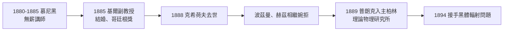

# 2.3 基爾與柏林：從邊緣學者到理論物理講席

1880至1885年，普朗克在慕尼黑大學以「無支薪講師」（Privatdozent）身分授課，沒有固定薪水，收入全靠學生學費，門庭冷落。1885年出現轉機：父親的人脈促成他獲聘基爾大學副教授（außerordentlicher Professor）。雖然仍是邊緣職位，但至少有了固定薪水。同年他與初戀瑪麗·默克（Marie Merck）結婚，並參加哥廷根大學的徵文比賽，以能量守恆原理的論文獲獎——評審之一恰好是亥姆霍茲。這個獎項在意義上大於獎金：它使柏林學界第一次注意到這個南方來的青年。

1888年底，命運的轉折降臨：柏林大學的克希荷夫去世，其理論物理講席出缺。亥姆霍茲本屬意波茲曼，波茲曼婉拒後又推薦了赫茲，赫茲亦未就任。在這一連串的婉拒之後，普朗克成為黑馬，1889年春受聘柏林大學副教授並執掌新建的理論物理研究所，1892年升正教授。1888年他也在柏林結識了波茲曼本人，並多次邀請這位維也納學者來柏林講學——兩人私誼漸深，儘管理論分歧依舊。此後十餘年，普朗克在柏林講授熱力學，學生寥寥，直到1894年一項新任務改變了一切。

**因果分析**：這段晉升之路處處是他人的放棄成就了自己的機會，波茲曼與赫茲的婉拒間接把普朗克推上德國理論物理中心。但真正的關鍵在於：柏林匯聚科學院與帝國物理技術研究所，普朗克置身其中，才會在1894年被引入黑體輻射的漩渦。基爾時期是他把熵理論打磨成熟的年代，柏林任命則是成熟的工具遇上了待解的問題，缺一不可。
