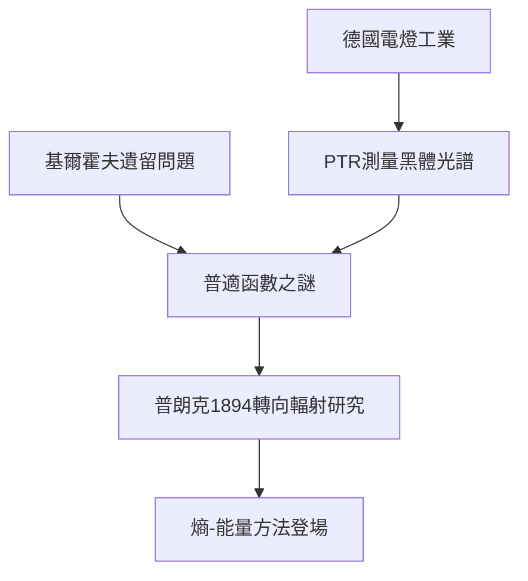

# 3.1 接受柏林大學教職與基爾霍夫遺留的問題

1889年基爾霍夫逝世，普朗克受邀接任柏林大學理論物理教授，1892年升為正教授。柏林是當時世界物理學的中心：亥姆霍茲主持大局，帝國物理技術研究院（Physikalisch-Technische Reichsanstalt, PTR）則擁有世界最好的計量實驗設施。PTR成立的背景是德國工業競爭：電燈工業需要可靠的光度標準，而黑體（能完全吸收一切入射輻射的物體）正是最理想的光源標準。於是「如何精確測量並描述黑體輻射光譜」同時成為工業問題與基礎科學問題。

基爾霍夫1859年已證明：黑體輻射的分佈函數 $u(\nu,T)$ 與腔壁材質無關，是自然界的普適函數——如同能量守恆般的普適量。1894年前後，普朗克被這個「普適性」吸引，正式將研究方向轉向輻射理論。他的策略延續其熱力學傳統：不去假設腔內電磁場的微觀機制，而是從輻射熵 $S$ 與能量 $U$ 的關係入手。

$$u(\nu, T) = \text{普適函數}$$

**因果分析**：這一節的因果鏈是「工業需求→實驗數據→理論危機」的典範。電燈工業（前因）驅動PTR的高精度量測（中間環節），而高精度量測正是日後揭穿維恩定律、引發紫外災變的直接武器。普朗克的轉向則由內外兩因共同驅動：內因是他對普適定律的執念，外因是柏林提供的實驗數據環境。沒有柏林這個「工業＋科學」複合生態，量子革命很可能推遲發生。
