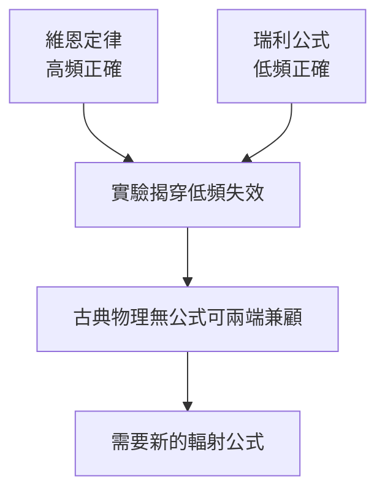

# 3.2 維恩定律與紫光區的量測危機

1896年，PTR的威廉．維恩（Wilhelm Wien）從熱力學推理結合實驗歸納，得到黑體輻射分佈的半經驗公式：

$$u(\nu, T) = a\,\nu^3\, e^{-b\nu/T}$$

這個維恩定律在高頻（短波、紫光與紫外）區與實驗吻合得很好，普朗克也高度讚賞，並於1899年試圖從輻射熵出發給它一個純熱力學的推導，自認已接近解決普適函數問題。

然而1900年，PTR的魯梅爾（Lummer）與普林斯海姆（Pringsheim）、以及庫爾鮑姆（Kurlbaum）與魯本斯（Rubens）對紅外長波區做了更精確的測量。結果顯示：在低頻高溫區，維恩定律系統性偏離實驗數據。維恩公式在 $\nu/T$ 大時正確，在 $\nu/T$ 小時失效。同時，瑞利（Lord Rayleigh）在英國從古典統計出發，得到在高頻區發散的能量分佈——若沿用古典物理的均分定理，腔內總能量將隨頻率無限增大，這就是所謂「紫外災變」（此名稱由埃倫費斯特於1911年提出）。古典物理在兩端同時失效：維恩公式保住了高頻、丟了低頻；瑞利公式保住低頻、卻在高頻爆炸。

**因果分析**：量測技術的進步（前因）直接製造了理論危機（後果）——若沒有魯本斯等人對長波紅外區的可靠數據，維恩定律可能再統治十年。這是「實驗驅動理論革命」的典型案例。對普朗克而言，危機也是機遇：1900年10月7日魯本斯拜訪並告知長波區實驗結果（低頻時 $u \propto T$），這條情報成為他內插公式的直接觸發事件。實驗家送來的邊界條件，決定了理論家造公式的兩個端點。
