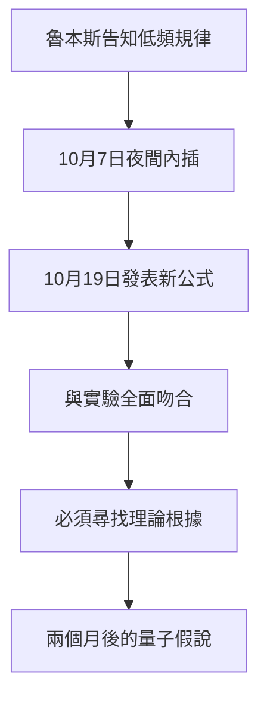

# 3.3 1900年10月內插出輻射公式

1900年10月7日（星期日），魯本斯夫婦拜訪普朗克家中，告知長波區的實驗結果：在 $\nu/T$ 很小時，輻射能量密度與絕對溫度 $T$ 成正比。普朗克當晚即著手「補救」。他的方法是赤裸裸的數學內插：在維恩公式（高頻極限）與魯本斯的低頻規律之間，用內插法造出一個中介函數的熵表示式，再對能量求導。數小時內，他得到：

$$u(\nu, T) = \frac{8\pi h \nu^3}{c^3} \cdot \frac{1}{e^{h\nu/kT} - 1}$$

其中 $h$ 是他引入的新常數（後稱普朗克常數），$k$ 是波茲曼常數。10月19日，他在德國物理學會的會議上以「維恩輻射定律的改進」為題發表此式。魯本斯連夜核對數據，發現它在所有頻段與實驗完全吻合——「不是近似，而是精確」。

但普朗克清楚，這只是一個形式優美的內插公式，是「幸運的猜測」，尚無物理根據。他在日後寫道：這是一個「孤注一擲的行動」（an act of desperation）。既然公式造出來了，就必須為它找到堅實的理論基礎——這個自我強加的義務，把他在兩個月內推向量子假說。

**因果分析**：這裡的因果順序是本書最關鍵的驅動關係：先有公式（果），後找理由（因）——與教科書式的「先理論後預言」完全相反。內插的成功反而製造了更大的壓力：公式越精確，越不可能只是巧合，於是解釋它的義務越沉重。前因（實驗數據＋美學信念）驅動內插；內插的精確吻合（中間事件）驅動下一步的根本性反思（後果）。科學革命往往不是勇敢的選擇，而是被自己的成功逼入牆角。
