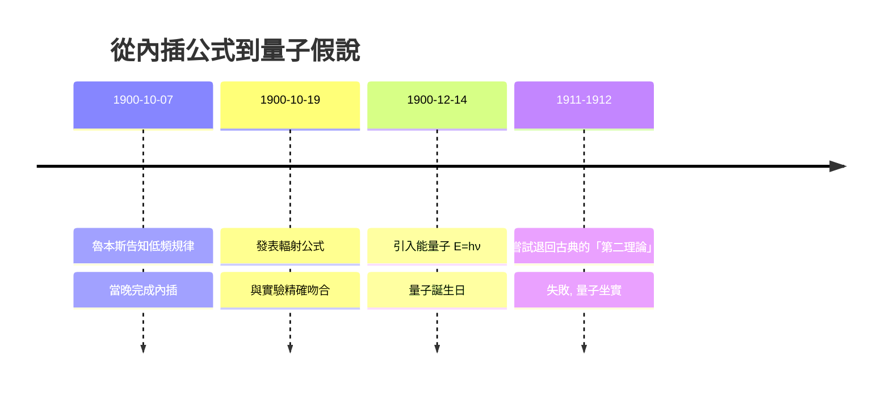

# 4.1 1900年12月14日：能量子的誕生

為了給10月19日的公式找理論根據，普朗克在1900年秋冬採取了他此前極端排斥的方法：波茲曼式的統計計數。他把腔內輻射與腔壁振子視為一組共振子（resonators），按能量把振子的總能量分成有限份，計算每種分配方式的組合數 $W$，再令 $S = k \log W$。要在數學上完成這個程序，他必須假設總能量由不可再分的「能量單元」組成：

$$E = h\nu$$

也就是說，頻率為 $\nu$ 的振子只能以 $h\nu$ 的整數倍吸收或發射能量。1900年12月14日，普朗克在德國物理學會宣讀《論正常光譜中能量分佈定律的理論》，正式提出能量子假說。這一天被視為量子理論的誕生日。

普朗克本人對這個假說極度不安。他視之為「形式上的假定」（Formal Harmlosigkeit），是一個推導工具而非物理實在；此後多年他反覆嘗試把量子退回古典連續理論的框架（所謂「第二理論」，1911-1912），均告失敗。他自述這是「孤注一擲」，但偉大的革命者恰恰是那個最不情願的革命者。

**因果分析**：這一節展現「方法借用」與「立場背叛」的因果迴環：為了解釋自己造的公式（前因），普朗克被迫採用他多年反對的波茲曼統計（中間轉折），而統計計數的數學要求又強迫他引入分立能量（後果）。整個鏈條中沒有一個環節是「想要革命」的動機——每一步都是上一步的邏輯俘虜。這解釋了為何量子假說由最保守的普朗克提出：正是他對公式精確性的執著，壓倒了對傳統的忠誠。
