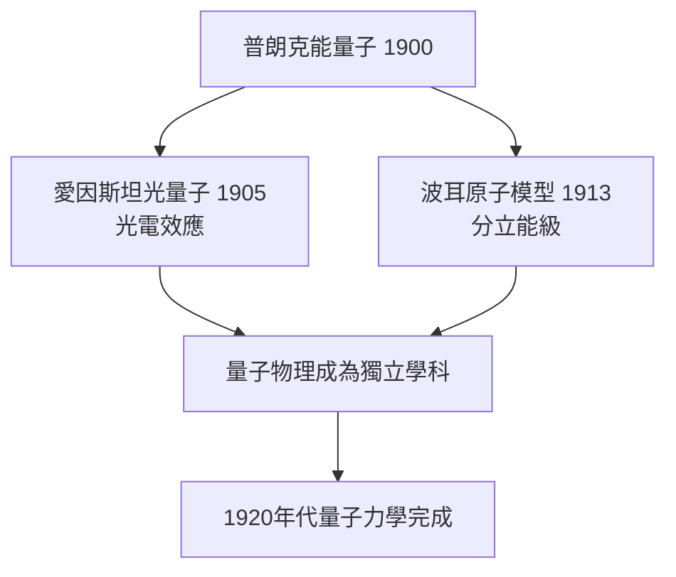

# 4.2 愛因斯坦光電效應與波耳原子的接棒

普朗克本人把量子當成數學手段，真正把 $h\nu$ 變成物理實在的是兩位後繼者。1905年，瑞士專利局的年輕職員愛因斯坦發表《關於光的產生和轉化的一個啟發性觀點》，主張光本身就是以 $h\nu$ 為能量的粒子（光量子），並以此解釋光電效應：

$$E_k = h\nu - \phi$$

普朗克起初極力反對這種「光粒子」說，認為愛因斯坦在輻射問題上「走過了頭」。但愛因斯坦的推理不需要輻射公式——他從實驗事實直接推出光量子的存在。1913年，正是普朗克（作為德國物理學會要員）參與起草推薦愛因斯坦進入普魯士科學院的信，信中還為愛因斯坦的光量子說「道歉」：他「可能有失誤，但不該因此苛責」。

1913年，哥本哈根的波耳（Niels Bohr）提出原子模型：電子只能在分立軌道上運動，躍遷時以 $h\nu$ 發射或吸收光。量子假說從輻射問題擴展到物質結構，成為解釋氫原子光譜的鑰匙。至此，普朗克1900年的「救火工具」蛻變為新物理學的地基。

**因果分析**：這裡的驅動關係是「接棒—擴張」：普朗克提供了常數 $h$（前因），愛因斯坦把它從「振子分立發射」提升為「光的內在性質」（後果一），波耳再把它推廣為「物質的能級結構」（後果二）。每一次接棒都比原提出者走得更遠，而普朗克的角色則從革命者轉為保守的守門人——他反對自己的創造物的延伸，反而證明了這延伸的獨立價值。三代人的互相驅動，使量子假說從應急補丁成長為範式。
