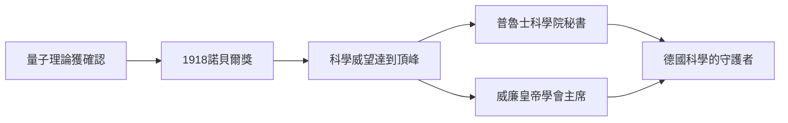

# 4.3 諾貝爾獎、德國科學界領袖與普朗克學會

量子的最終承認以1918年諾貝爾物理學獎（1919年補頒）落到普朗克頭上作為標誌。此後他成為德國科學體系的支柱型人物：1912年起擔任普魯士科學院常務秘書，1930年出任威廉皇帝學會（Kaiser-Wilhelm-Gesellschaft）主席，並長期參與德國物理學會、標準計量與大學政策等事務。他提拔與庇護了大量人才：推薦愛因斯坦進柏林科學院（1914）、支持勞厄（1914年諾獎）與海森堡、薛丁格一代人的新量子力學。愛因斯坦稱讚他是「把愛護人與愛護事業結合得最好的人」。

第一次世界大戰期間，普朗克與大多數德國知識份子一樣簽署支持祖國的《九三宣言》，戰後則投身科學界重建與國際修好，1920年代親自促成德國科學家重返國際學術圈。作為行政領袖，他治學的保守性格反而成為優點：講規則、重程序、在政治震盪中維持機構的存續。

$$E = h\nu, \quad \Delta E = h\nu$$

這兩個式子如今已成常識，但在1918年諾獎授獎詞中，能量子假說仍被稱為「與整個古典物理學對立的英雄行為」。

**因果分析**：科學革命的承認（前因：量子被實驗與理論反覆確認）驅動普朗克個人威望的累積（中間事件），威望又轉化為制度權力（後果：科學院與威廉皇帝學會的領導地位）。這個權力在和平時期用於庇護人才（愛因斯坦、勞厄），但在1933年後的政治劇變中，同一個位置將使他面對無法兩全的抉擇——科學領袖的身分既是資源，也是枷鎖。威望的因果鏈在此轉入下一章的悲劇軌道。
