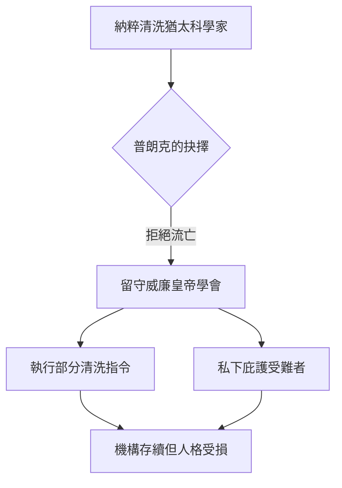

# 5.1 納粹時代：抗爭、妥協與留守

1933年希特勒上台後，猶太科學家遭到系統性清洗。普朗克選擇了一條爭議至今的路線：他沒有流亡，而是留守機構，認為「保存科學的火種」比個人抗議更有價值。1933年5月，他當面求見希特勒，懇請不要讓愛因斯坦等人離開德國，據載希特勒暴怒回絕；普朗克隨後仍簽署了學界效忠的宣言，並在清理威廉皇帝學會猶太職員時執行了不少納粹指令，同時私下庇護部分受迫害者。

他說：「如果你今天找到30個有骨氣的人，明天就會有150個站出來反對你。」這句話道出他的絕望判斷：公開抗爭只會玉石俱焚，留守是唯一的現實選擇。1935年，他不顧禁令出席已故化學家哈伯（Fritz Haber，猶太裔）的紀念會，是極少數公開的尊嚴之舉。1936年他辭去科學院秘書職，1937年辭去物理學會職務，但一直擔任威廉皇帝學會主席至1937年後仍以會長身分週旋，直至1945年德國崩潰。

**因果分析**：普朗克的選擇由「制度忠誠」與「無力感」共同驅動（前因），產生的後果是矛盾的：一方面威廉皇帝學會在戰火中勉強存續，為戰後重建保留了骨架；另一方面他與政權合作的紀錄成為其一生名節的污點。這是典型的「留守者困境」：前因（愛惜科學機構）驅動妥協（中間事件），妥協又反過來侵蝕道德資本（後果）。與愛因斯坦的流亡路線互為對照，兩條路都付出了代價。
