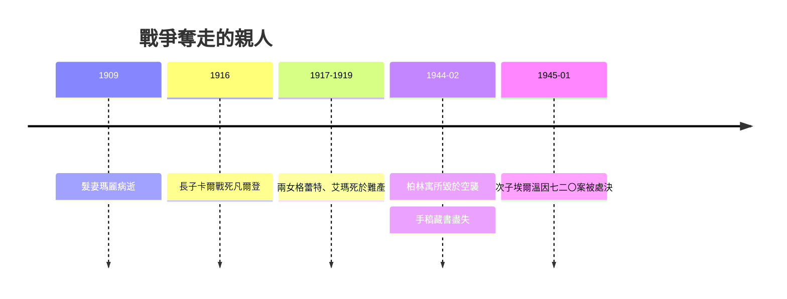

# 5.2 家園毀於戰火與親人之殤

普朗克一生經歷兩次世界大戰，而戰爭奪走的不是抽象的名譽，而是他的至親。第一次世界大戰中，長子卡爾戰死於凡爾登戰役，次子埃爾溫被法軍俘虜；兩個女兒格蕾特與艾瑪又分別於一九一七年和一九一九年死於難產。髮妻瑪麗早在一九〇九年病逝，普朗克在中年即已嚐盡喪偶喪女之痛。他將悲痛壓抑於普魯士式的克制之中，惟以更繁重的工作麻痺自己，這種壓抑反而鞏固了他以職責對抗命運的人格。

更大的打擊在第二次世界大戰降臨。一九四四年二月，盟軍空襲柏林，普朗克在格魯訥瓦爾德的寓所被炸毀，手稿、藏書與愛因斯坦往來書信盡成灰燼。同年七月二十日，施陶芬貝格暗殺希特勒失敗，與普朗克過從甚密的次子埃爾溫因牽涉密謀被捕，隔年一月被處決。普朗克晚年最信任的兒子，成為他留守路線也未能庇護的人。

**因果分析**：戰爭與喪親構成雙向因果。一方面，國家主義的前因把普朗克的兒子送上戰場，把德國物理學推向軍國體制的附庸；另一方面，喪親的後果反過來改變了普朗克的政治判斷，使他由一九一四年的主戰簽署者轉為威瑪時期的國際和解者，又在一九三三年後執著於保存機構以避免更大犧牲。家破人亡的私痛與德國科學存續的公義在他身上互相驅動，最終使晚年的普朗克既不被納粹信任，也不被流亡者完全諒解，陷於孤獨的道德夾縫。
