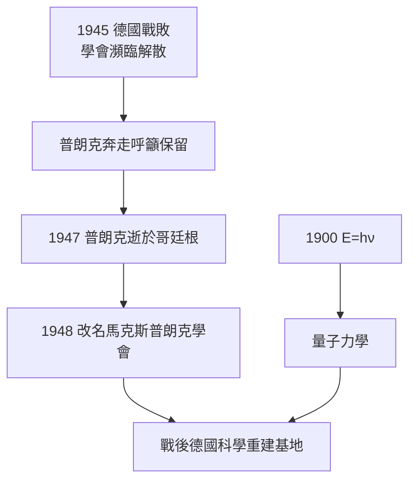

# 5.3 戰後重生：普朗克學會的命名與量子遺產

一九四五年德國戰敗時，普朗克已八十七歲，無家可歸，暫居哥廷根友人處。他親眼見到威廉皇帝學會在廢墟中掙扎求生，遂以個人威望四處奔走，說服盟軍保留這個研究網絡。一九四七年十月四日，他在哥廷根逝世。次年，為表彰其守護德國科學的功績，威廉皇帝學會改名為馬克斯普朗克學會，今日已成為與英國皇家學會、美國國家科學院並列的世界級基礎研究機構。

普朗克的科學遺產則早已超越機構。以他命名的普朗克常數與普朗克單位系，標誌著人類認識的極限尺度：

$$E = h\nu, \quad l_P = \sqrt{\frac{\hbar G}{c^3}}, \quad E_P = \sqrt{\frac{\hbar c^5}{G}}$$

從海森堡矩陣力學到薛丁格波動力學，再到量子場論與量子資訊，二十世紀物理學的每一次躍進都回頭確認一九〇〇年十二月十四日那個不情願的起點。普朗克以保守者之身播下革命的種子，以失敗的外交保全了科學的火種。

**因果分析**：改名事件是全書因果鏈的收束。前因有二：一是科學上的不朽貢獻使普朗克之名成為德國科學正統性的象徵資本，二是他在納粹時代留守護院的苦勞使盟軍願意保留舊機構的骨架。後果則是雙重的：普朗克學會繼承了威廉皇帝學會的設備與人才，得以迅速重建；量子遺產則通過新一代物理學家反哺學會，使其在量子光學與凝聚態領域長期領先。個人之因結出制度之果，制度之果又孕育新的科學之因，普朗克的一生至此完成閉環。
