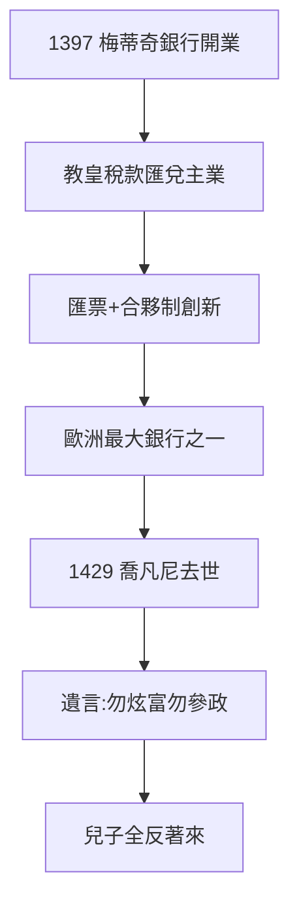

# 1.2 喬凡尼銀行（1397）

## 1397 年 10 月 1 日：開業

喬凡尼在佛羅倫斯開設梅蒂奇銀行（Banco Medici）。主業：教皇稅款匯兌（什一稅從全歐流向羅馬，經手費驚人）+ 羊毛貿易融資。1400 年代，成為教皇的官方銀行——**上帝的錢，梅蒂奇管**。

## 銀行的創新

- 匯票（bill of exchange）：規避教會高利貸禁令，匯差即利息；
- 複式記賬的早期實踐（後由威尼斯人系統化）；
- 分行經理合夥制：經理出小錢、擔大責，總部控股——加盟連鎖的雛形。

## 1429：去世與遺產

喬凡尼 1429 年去世，留下兩個兒子：科西莫（1389–）與洛倫佐（1395–，老洛倫佐系，後來的分支）。遺言：「不要炫富，不要參政。」——兒子一條也沒聽（第 2 章）。

**因果**：伯父的人脈（1.1）+ 教皇的錢 = 銀行帝國。喬凡尼的遺言是明智的，但財富的邏輯是：錢多了，不參政也得參政——下一節，銀行網絡。
