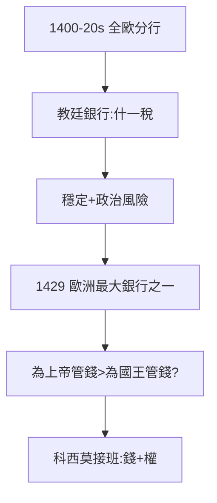

# 1.3 銀行網絡（1400–1429）

## 分行：羅馬、威尼斯、日內瓦、倫敦、布魯日

1400–20 年代，梅蒂奇銀行在全歐開分行：羅馬（教皇）、威尼斯（貿易）、日內瓦（匯兌）、倫敦（羊毛）、布魯日（北方）。網絡即權力——15 世紀的 SWIFT。

## 教皇的錢袋

- 康斯坦茨會議（1414–18）解決教會大分裂，梅蒂奇為新教皇馬丁五世管錢，一舉成為教廷銀行；
- 教皇的錢有個好處：穩定（什一稅年年有）；有個壞處：教皇換人，合同重談——政治風險的源頭（後來的利奧十世揮霍，見 4.1）。

## 1429 年的規模

去世時，梅蒂奇銀行是歐洲最大銀行之一，資產折合數噸黃金。喬凡尼證明：**為上帝管錢，比為國王管錢更穩**（對照羅斯柴爾德的王室路線，見《羅斯柴爾德傳》——教皇不換國籍，國王會換朝代）。

**因果**：分行網絡 + 教皇壟斷 = 金融帝國。1429 年，錢的問題解決了，權的問題來了——下一章，科西莫。
