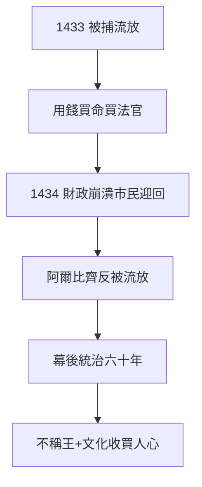

# 2.1 流放與回歸（1433–1434）

## 1433 年 9 月：被捕流放

科西莫（Cosimo，1389–）因支持平民派，得罪寡頭阿爾比齊（Albizzi），被控叛國，判死刑（後改流放威尼斯）。他在獄中用錢買通看守、買通法官——**錢能通神，佛羅倫斯證明**。

## 1434 年 10 月：凱旋回歸

流放一年，佛羅倫斯財政崩潰（戰爭 + 阿爾比齊加稅），市民暴動迎回科西莫。阿爾比齊反被流放——**用錢買回來的城邦**。從此梅蒂奇幕後統治佛羅倫斯六十年（2.2）。

## 流放的教訓

- 不住宮殿、不稱王（父親遺言 1.2 的一半：勿炫富，聽了；勿參政，沒聽——改為「參政但不稱王」）；
- 「國王之父」模式：當無冕之王，比戴王冠安全（後代忘了這一點，見第 4 章）；
- 贊助的開始：回歸後大興土木（2.3），收買人心——**文化即政治**。

**因果**：銀行網絡（1.3）的錢 → 買回城邦。1434 年是梅蒂奇王朝的真正起點——不是開業（1397），是奪權。下一節，幕後統治的藝術。
