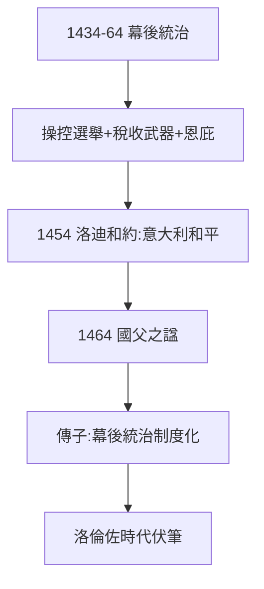

# 2.2 幕後統治（1434–1464）

## 無冕之王的技術

科西莫統治三十年（1434–64），職務只是普通公民，但：

1. **操控選舉**：選舉委員會（Accoppiatori）由親信組成，抽籤箱裡全是自己人；
2. **稅收武器**：災難稅（catasto）精確打擊政敵財產；
3. **恩庇網絡**：貸款給朋友，高薪給支持者——銀行即政府。

## 外交：洛迪和約（1454）

科西莫促成米蘭-那不勒斯-佛羅倫斯同盟，結束倫巴第戰爭，意大利和平四十年（洛迪和約體系）——馬基雅維利（後來的佛羅倫斯人）在《君主論》中讚揚他是「武裝先知」的反面：**不武裝的君主**。

## 1464：國父之死

去世時，市政府上諡「國父」（Pater Patriae）——佛羅倫斯兩千年歷史上唯一的國父。葬禮簡樸（聽父親的話：勿炫富），權力傳給痛風的兒子皮耶羅——幕後統治的制度化（傳子）。

**因果**：流放回歸（2.1）→ 幕後統治 → 國父之諡。科西莫證明：錢 + 低調 = 長治久安——而他的孫子洛倫佐將證明：錢 + 高調 = 短暫輝煌（第 3 章）。下一節，贊助。
