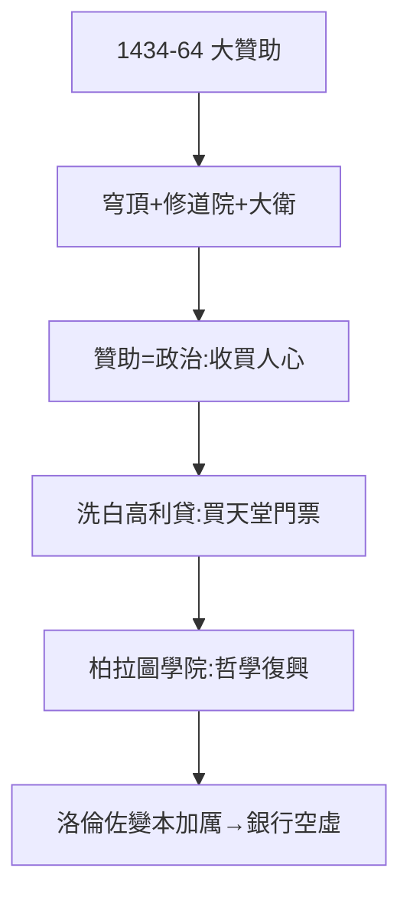

# 2.3 贊助（1434–1464）

## 花錢的藝術

科西莫花在藝術上的錢，超過佛羅倫斯歷史上任何人：

- **布魯內萊斯基穹頂**（1420–36）：聖母百花大教堂穹頂，文藝復興建築的開端（科西莫是主要贊助人之一）；
- **聖馬可修道院**：出資重建，藏書樓（歐洲第一個公共圖書館之一）；
- **多納泰羅**：大衛像（第一尊文藝復興裸體雕塑）、聖喬治；
- **弗拉·安傑利科**：修道院壁畫。

## 贊助即政治

- 收買人心：公共建築歸全城，榮耀歸梅蒂奇（2.1 的延續）；
- 洗白高利貸：教會譴責放貸，藝術捐贈贖罪——**天堂的門票，用穹頂買**；
- 柏拉圖學院：出資支持費奇諾翻譯柏拉圖全集——新柏拉圖主義，文藝復興的哲學。

## 1464 年的賬本

去世時，家族為藝術花費折合數十萬弗羅林——銀行利潤的藝術化。後人（洛倫佐）變本加厲（3.1），直到銀行空虛（3.3 的財政危機伏筆）。

**因果**：幕後統治（2.2）需要合法性，藝術提供合法性。但藝術是無底洞——科西莫花得起，孫子花不起（第 3 章）。下一章，洛倫佐。
