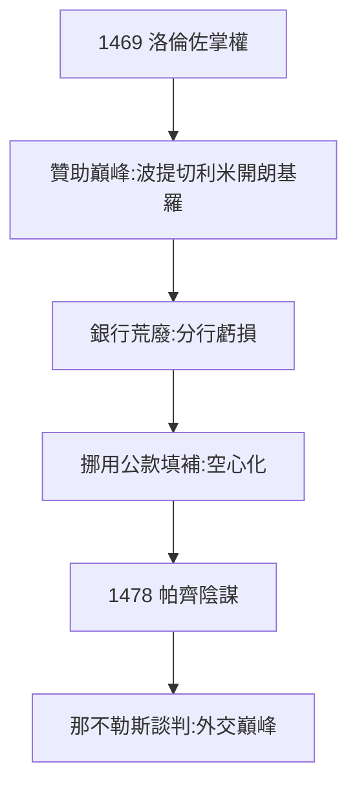

# 3.1 華麗者（1469–1478）

## 1469：洛倫佐掌權

科西莫之孫洛倫佐（Lorenzo，1449–）20 歲接班（父親皮耶羅痛風早死）。外號「華麗者」（il Magnifico）——詩人、運動員、外交家、銀行家（最不稱職的身份）。他擴大贊助：波提切利（春、維納斯的誕生）、米開朗基羅（少年時代住在他家！）、波利齊亞諾。

## 天才的代價：銀行荒廢

洛倫佐無心經營，銀行分行連連虧損（倫敦房倒閉、布魯日房巨虧），靠挪用佛羅倫斯公款填補——**用國庫養銀行，用銀行養藝術**。財政的空心化，1478 年後爆發（3.3）。

## 外交：維持均勢

延续祖父（2.2）的洛迪體系，在米蘭、那不勒斯之間走鋼絲。1478 年帕齊陰謀（3.2）後，他親赴那不勒斯談判，避免戰爭——外交家的巔峰。

**因果**：科西莫的低調（2.2）→ 洛倫佐的高調；科西莫的銀行（1.3）→ 洛倫佐的提款機。輝煌與空心同步——下一節，陰謀。
