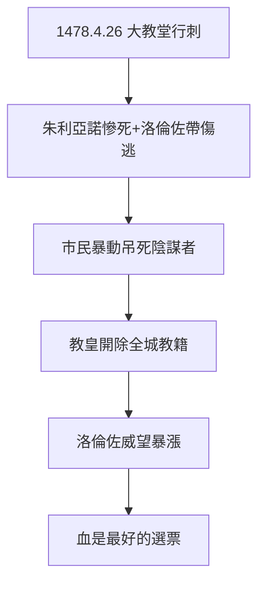

# 3.2 帕齊陰謀（1478）

## 1478 年 4 月 26 日：大教堂的血

復活節彌撒，帕齊家族（銀行競爭對手）聯合教皇西斯都四世（討厭梅蒂奇），在大教堂行刺：弟弟朱利亞諾被砍死（19 刀），洛倫佐帶傷逃進聖器室，市民暴動，把陰謀者吊死在市政廳窗口——包括比薩大主教（穿著法衣被吊死，教皇震怒，開除佛羅倫斯全城教籍）。

## 陰謀的根源

- 銀行競爭：帕齊想取代梅蒂奇的教廷銀行地位；
- 教皇的敵意：西斯都四世與梅蒂奇爭奪伊莫拉城；
- 洛倫佐的高調（3.1）：樹大招風，仇人比祖父多十倍。

## 因禍得福

刺殺未遂，洛倫佐威望暴漲：市民同情、詩人歌頌（波利齊亞諾寫《帕齊陰謀史》）、那不勒斯談判（3.1）成功——**血是最好的選票**。但弟弟的死是永遠的痛：他此後鬱鬱寡歡，詩越寫越哀。

**因果**：高調的代價（3.1）→ 陰謀 → 威望。1478 年的血，鞏固了梅蒂奇——但銀行的血（虧損）止不住。下一節，1494 年的總崩潰。
