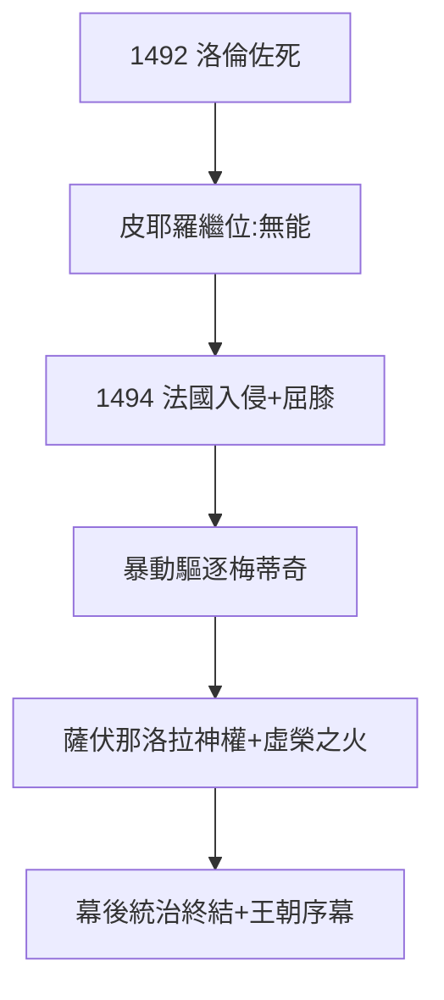

# 3.3 1494 驅逐（1492–1494）

## 1492：洛倫佐之死

洛倫佐 43 歲病死（痛風 + 操勞），臨終召薩伏那洛拉（Savonarola，激進修士）懺悔，傳說修士要他歸還佛羅倫斯自由，他拒絕——「華麗者」的終點，是拒絕自由。兒子皮耶羅（無能，人稱「倒霉的皮耶羅」）繼位。

## 1494：法國入侵與驅逐

法王查理八世入侵意大利，皮耶羅屈膝求和（割地賠款），佛羅倫斯暴動，梅蒂奇被驅逐，宮殿被洗劫。薩伏那洛拉建立「上帝之城」（神權統治，焚燒「虛榮之火」：藝術品、書籍、假髮付之一炬）——**文藝復興的心臟，被自己的道德家燒了一把火**。

## 1494 的意義

- 梅蒂奇幕後統治（2.2）終結：錢沒了（銀行空心，3.1），人沒了（洛倫佐死），勢沒了（法國人來了）；
- 但故事沒完：教皇與公爵的時代（第 4 章）即將開始——梅蒂奇從銀行家變成王朝。

**因果**：銀行的空心（3.1）+ 接班人的無能 + 外敵入侵 = 1494。六十年幕後統治（2.2）一夜歸零——但梅蒂奇學會了新遊戲：不再幕後，直接戴冠（第 4 章）。下一章，教皇。
