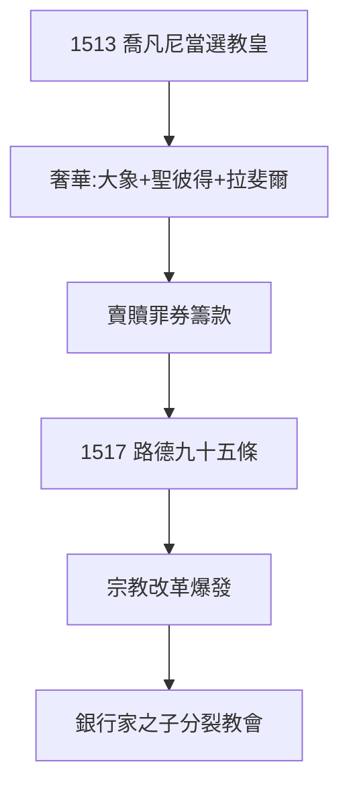

# 4.1 利奧十世（1513–1521）

## 1513：喬凡尼當選教皇

洛倫佐之子喬凡尼（1475–）37 歲當選教皇利奧十世（Leo X）——梅蒂奇從銀行家變成基督世界之主。1494 年被驅逐（3.3），十九年後以教皇身份凱旋：1512 年西班牙軍隊幫梅蒂奇重返佛羅倫斯，1513 年登基。

## 「上帝給了我們教皇職位，讓我們享受它」

利奧十世的名言（據傳）：“God has given us the papacy, let us enjoy it.”——文藝復興教皇的奢華：養大象（漢諾，拉斐爾為它畫像）、建聖彼得大教堂（賣贖罪券籌款——**路德 1517 年九十五條的直接導火索**，見《馬丁路德傳》2.3）、贊助拉斐爾（雅典學院）。

## 1517：雙重引爆

- 利奧十世賣贖罪券 → 路德九十五條（1517.10.31）→ 宗教改革；
- 梅蒂奇的教皇，為新教做了嫁衣——歷史的幽默：**銀行家的兒子，分裂了教會**。

**因果**：1494 年的驅逐（3.3）→ 1513 年的教皇。梅蒂奇學會了新遊戲（戴冠），但王冠的代價是教會的分裂——利奧十世至死沒明白路德是誰（稱之為「醉修士」，三年自醒）。下一節，公爵。
