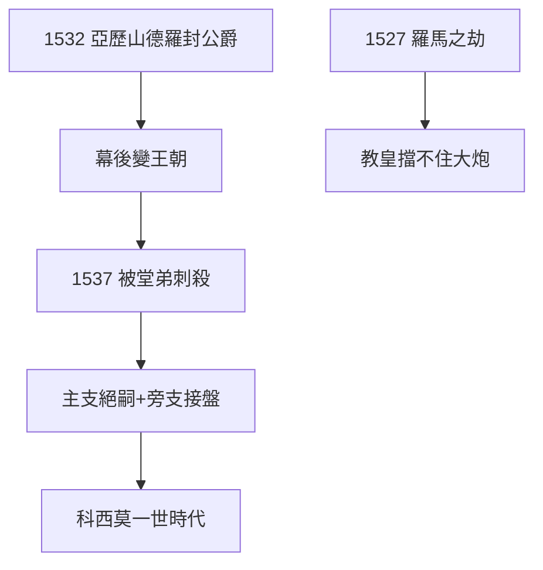

# 4.2 亞歷山德羅公爵（1532–1537）

## 1532：第一位公爵

教皇克雷芒七世（梅蒂奇家第二位教皇，朱利奧，利奧十世之侄）封亞歷山德羅（洛倫佐之孫，傳說有黑人血統——母親是女僕）為佛羅倫斯公爵——**幕後統治（2.2）正式加冕，梅蒂奇從家族變王朝**。

## 暴君的五年

亞歷山德羅殘暴荒淫，1537 年被堂弟洛倫齊諾（小洛倫佐）刺殺（「佛羅倫斯的布魯圖斯」）——王朝的第一位公爵，死於家族內鬥。無合法子嗣，旁支科西莫（老洛倫佐系，1.2 的次子之後）繼位——**主支絕嗣，旁支接盤**。

## 1527：羅馬之劫的陰影

克雷芒七世在法西之間搖擺，1527 年帝國軍隊洗劫羅馬（米開朗基羅目睹）——教皇的權力，敵不過皇帝的大炮。梅蒂奇的教皇時代（利奧 + 克雷芒）證明：精神的王冠，擋不住世俗的大炮。

**因果**：利奧的教皇（4.1）→ 克雷芒的教皇 → 亞歷山德羅的公爵。王冠一個比一個小（教皇→公爵），卻一個比一個實——公爵是世襲的，教皇是選的。下一節，大公。
