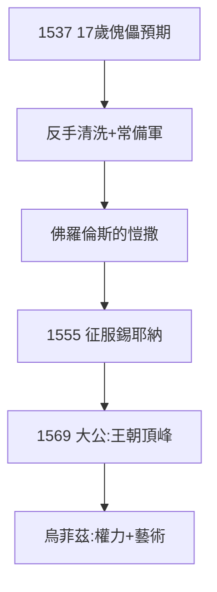

# 4.3 科西莫一世大公（1537–1569）

## 1537：旁支少年掌權

17 歲的科西莫（老洛倫佐系，與主支已遠）被推舉為公爵——傀儡預期。他反手清洗：處死共和派，趕走西班牙駐軍，建立常備軍、秘密警察——**佛羅倫斯的愷撒**，比祖先科西莫（2.2）狠十倍。

## 1569：托斯卡納大公

教皇庇護五世封他為托斯卡納大公（Grand Duke）——梅蒂奇王朝的頂峰：從銀行家（1397）到大公（1569），172 年。領土：佛羅倫斯 + 比薩 + 錫耶納（1555 征服）——托斯卡納基本統一。

## 烏菲茲的誕生

1560–81 年建烏菲茲宮（Uffizi，本意「辦公室」），收藏家族藝術品——今天的世界第一美術館之一。科西莫一世懂：**權力需要宮殿，宮殿需要藝術**（2.3 的延續，換成王朝版）。

**因果**：亞歷山德羅之死（4.2）→ 旁支接盤 → 大公。172 年，從招牌（紅藥丸，1.1）到王冠。梅蒂奇完成了羅斯柴爾德沒走的路（《羅斯柴爾德傳》：保持銀行家）——而王冠的代價，是創造力的死亡（第 5 章）。下一章，衰落。
