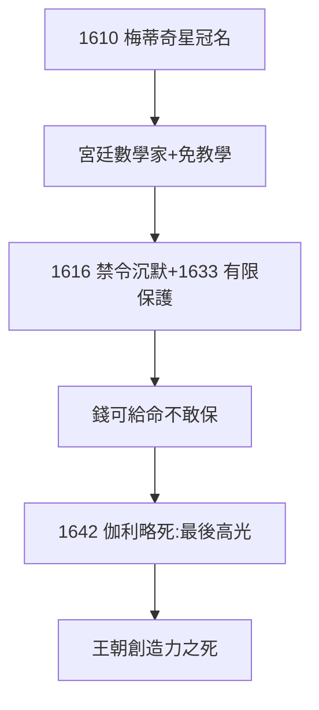

# 5.1 伽利略贊助（1610–1642）

## 1610：木星衛星獻名

伽利略發現木星四衛星，獻給科西莫二世（大公），命名「梅蒂奇星」（Medicean Stars）——科學史上最成功的「冠名贊助」。科西莫二世聘他為宮廷數學家，年薪 1000 弗羅林，免除教學——**伽利略的自由，梅蒂奇買單**。

## 1616–33：審判中的梅蒂奇

- 1616 年哥白尼禁令，大公保持沉默；
- 1633 年審判，托斯卡納大使館為伽利略提供住所（軟禁在錫耶納大主教宮五個月，條件優渥）；
- 有限的保護：大公不敢得罪教皇（烏爾班八世曾是梅蒂奇的朋友，翻臉比翻書快）——**贊助的邊界：錢可以給，命不敢保**。

## 1642：伽利略之死

伽利略死於阿切特里別墅，大公出資治喪。梅蒂奇王朝最後的文化高光——此後二百年，托斯卡納再無世界級人物。錢還在，眼睛瞎了（王朝的創造力隨銀行一起死了，見 5.2）。

**因果**：烏菲茲的傳統（4.3：權力+藝術）→ 伽利略的冠名。但贊助科學不同於贊助藝術：藝術不惹教皇，科學惹——梅蒂奇的錢，買得起望遠鏡，買不起異端審判的無罪判決。下一節，最後的大公。
