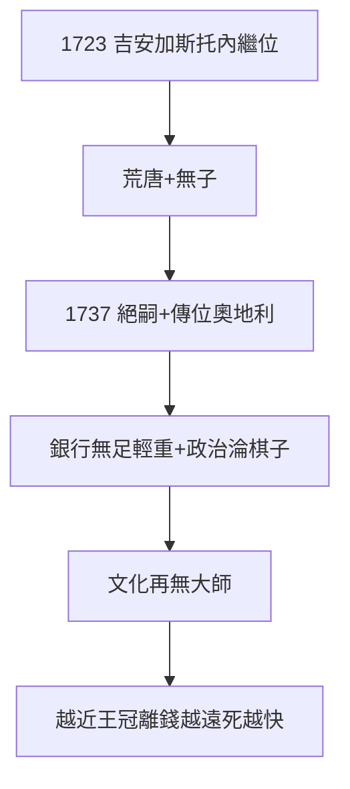

# 5.2 最後的大公（1723–1737）

## 吉安·加斯托內：荒唐的終章

1723 年，吉安·加斯托內（Gian Gastone）繼位：同性戀、酗酒、把宮廷變成妓院（傳說），托斯卡納在他手中徹底哈布斯堡化（死後傳位奧地利，1748 年艾克斯拉沙佩勒條約確認）。無子，梅蒂奇男系絕嗣。

## 衰落的賬本

- 銀行：16 世紀後已無足輕重（尼德蘭、英國銀行崛起）；
- 政治：淪為歐洲棋子（西班牙、奧地利輪流駐軍）；
- 文化：除了伽利略（5.1），17–18 世紀再無大師——**錢還在，魂沒了**。

## 王朝的壽命

1397 開業 → 1737 絕嗣：340 年。其中銀行家 100 年（1397–1494），幕後統治 60 年（1434–94），王朝 200 年（1532–1737）。**越接近王冠，離錢越遠；離錢越遠，死得越快**——梅蒂奇定律。

**因果**：大公的頂峰（4.3）→ 兩百年下坡。172 年上山（1397–1569），168 年下山（1569–1737）——對稱的悲劇。而最後的榮光，屬於一個女人（下一節）。
