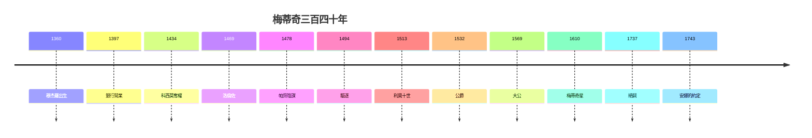

# 5.3 安娜的約定（1743）

## 1743：家族契約（Patto di Famiglia）

吉安·加斯托內之姐安娜·瑪麗亞·路易莎（Anna Maria Luisa，1667–1743），梅蒂奇最後的血脈，立下遺囑：家族全部藝術收藏（烏菲茲、皮蒂宮的藏品）**永遠留給佛羅倫斯，不得搬離**——條件是奧地利（新統治者）保證向公眾開放。歐洲歷史上第一份「文化遺產不可移動」契約。

## 約定的遠見

- 沒有這份契約，哈布斯堡會把藏品搬空（維也納、德累斯頓的前車之鑑）；
- 有了它，烏菲茲成為世界第一批公共美術館，佛羅倫斯成為旅遊聖城；
- 安娜本人：守寡、無子、晚年隱居，唯一的政治行動，就是這份遺囑——**一生只做一件事，做對了**。

## 蓋棺：銀行家族的最終產品

梅蒂奇三百四十年，最終產品不是銀行（倒了）、不是王朝（絕了）、不是教皇（分裂了教會），而是**一座城市的美**：穹頂（2.3）、烏菲茲（4.3）、大衛、維納斯的誕生……——錢會貶值，權會過期，美永生。

**因果閉環**：鄉下人的銀行（1.1–1.3）→ 幕後統治（2.2）→ 藝術贊助（2.3）→ 王朝（第 4 章）→ 絕嗣（5.2）→ 安娜的約定（本節）。**起於錢，終於美**——梅蒂奇證明：銀行家的最高境界，不是當國王，是當繆斯。而繆斯的代價，是整個家族。
