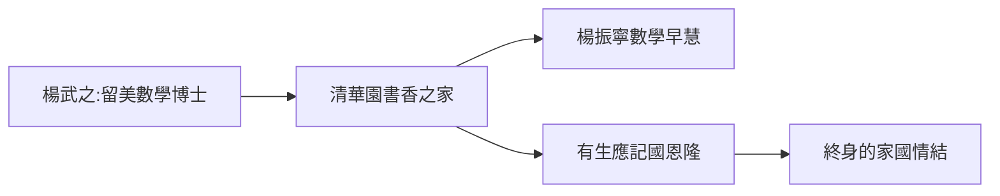

# 1.1 合肥的童年

1922 年 10 月 1 日，楊振寧出生於安徽合肥。父親楊武之是中國第一批留美數學博士（芝加哥大學，1928），母親羅孟華。楊武之回國後任教廈門、清華等校，楊振寧的童年大半在北平清華園度過——一個被數學書包圍的家。

## 數字的早慧

- 五歲認字、算術超前同齡；
- 小學時讀父親書房裡的數學書，據回憶「雞兔同籠」之類的題一點就通；
- 父親的教法：不催促、不強迫，只在孩子提問時給出最精確的回答。

父親的座右銘被楊振寧記了一生：「**有生應記國恩隆**」——把個人學問與國家命運綁在一起。這句話解釋了楊振寧後半生幾乎所有關於「回國」的選擇。

## 亂世中的書桌

1927–1937 年是相對安定的十年，楊振寧在北平讀完小學和中學。清華園的教師子弟圈子裡，他結識了日後的終身摯友鄧稼先——一個將在二十年後與他走上完全不同道路的人。

**因果**：父親的數學訓練給了他抽象思維的第一課，「國恩」家訓則種下了 1971 年回國、晚年定居清華的種子。童年的清華園，是他一生的起點，也是終點。
