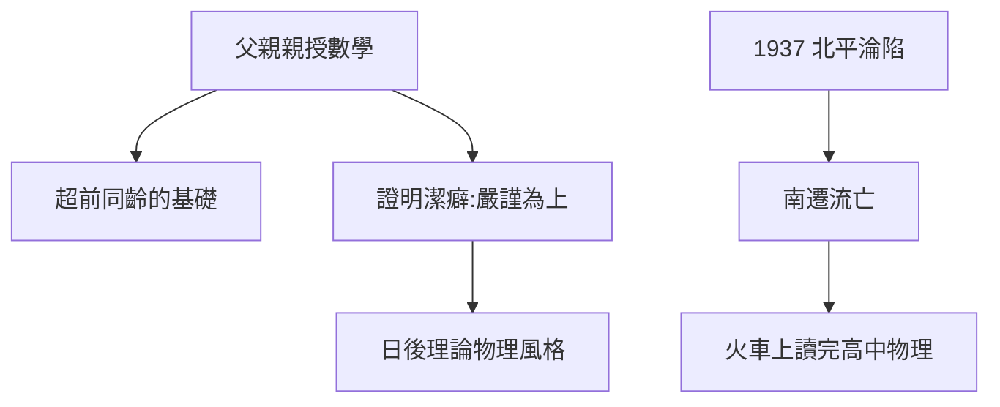

# 1.2 清華園的數學啟蒙

## 中學時代的數學狂熱

在北平崇德中學，楊振寧的數學成績鶴立雞群。父親楊武之親自為他開小灶：初等數論、解析幾何、微積分預備知識。這種「父親即導師」的模式，使他的數學基礎遠超同齡人——多年後他回憶，芝加哥大學的某些課程對他而言「只是複習」。

關鍵的一課來自父親的治學態度：楊武之研究的是數論中的華林問題，論文不多但要求嚴格。他教兒子：**一個定理，要麼證明得無懈可擊，要麼不要發表**。這種潔癖式的嚴謹，後來成為楊振寧理論物理風格的底色。

## 1937：北平淪陷

1937 年 7 月盧溝橋事變，日軍佔領北平。清華、北大、南開三校南遷，組建長沙臨時大學，旋即再遷昆明為西南聯大。楊家隨校南下，顛沛流離中，楊振寧的中學學業中斷。

在逃難路上，他帶著的幾本書中有一本高中物理——顛簸的火車上，他第一次系統讀完力學與電磁學。後來他說：「戰爭讓我明白，**物理學是理解這個動盪世界的另一種語言**。」

**因果**：父親的數學家訓練給了他「武器」，戰爭則給了他「問題意識」——為什麼世界如此混亂，背後有沒有秩序？這個問題把他從純數學推向了物理。
