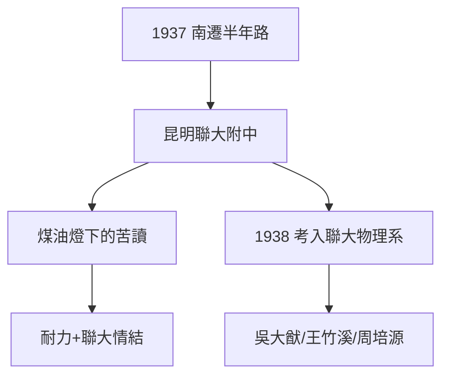

# 1.3 抗戰流亡與南遷

## 千里南遷

1937 年底至 1938 年初，楊家隨清華南遷隊伍經鄭州、武漢、香港、海防、河內，最後抵達昆明。這條路走了近半年——行李中除了衣物，就是父親的書和楊振寧的習題本。

## 昆明：聯大附中

在昆明，楊振寧進入西南聯大附中（時稱「國立西南聯大附設中學」）完成高中學業。聯大附中的師資堪稱豪華：許多聯大教授親自授課。物質條件卻極差：土牆茅屋、空襲警報是日常，學生夜裡借著煤油燈讀書。

這段經歷塑造了他的兩個特質：

1. **吃苦的耐力**：後來在普林斯頓連續數月每天工作十幾小時，同事驚訝，他卻說「比起昆明，這不算什麼」；
2. **聯大情結**：西南聯大「剛毅堅卓」的校訓，成為他一生認同的精神原鄉。

## 1938：考入西南聯大

1938 年秋，16 歲的楊振寧以優異成績考入國立西南聯大。原本想讀物理系，卻因志願填報陰差陽錯——他報的是「化學系」？不，史實是：他考入的是物理系前身分流後的安排。實際上他順利進入物理系（當年聯大物理系大師雲集：吳大猷、周培源、王竹溪、饒毓泰）。

**因果**：流亡沒有摧毀他的學業，反而把他送進了中國近代史上師資最強的物理系。下一章，吳大猷與王竹溪將把這塊璞玉雕成赴美留學的料。
