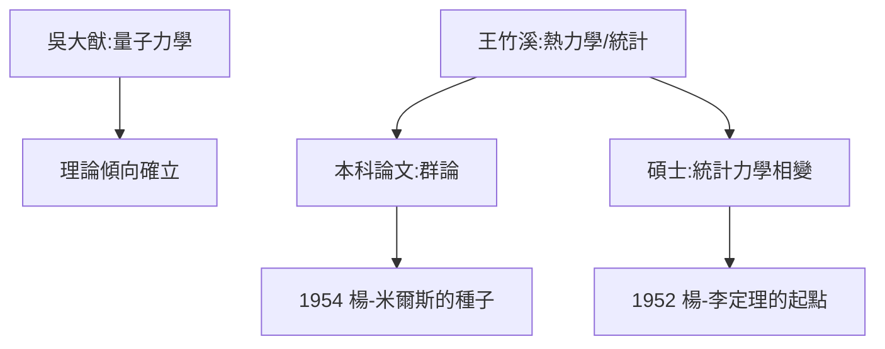

# 2.1 西南聯大歲月

## 大師雲集的鐵皮屋

1938–1942 年，楊振寧在昆明的鐵皮教室裡聽吳大猷講量子力學、王竹溪講熱力學、周培源講電動力學、饒毓泰講光學。聯大物理系的課程水準與世界同步——吳大猷的《量子力學》講義後來成為經典教材。

楊振寧的成績名列前茅，但他的興趣明顯偏向理論：實驗課上他「手笨」的名聲已經傳開（多年後費米也得出同樣結論）。王竹溪看出了這一點，指導他轉向統計力學與理論方向。

## 本科論文：群論的初戀

1942 年的學士論文，在王竹溪指導下研究群論在分子振動中的應用。這是他第一次接觸**群表示論**——十二年後，楊-米爾斯理論的核心正是非阿貝爾規範群 $SU(2)$ 的表示。可以說，聯大本科論文埋下了他一生最重要的數學種子。

## 1942：聯大助教與碩士

本科畢業後留校任助教，同時攻讀碩士，師從王竹溪研究統計力學。1944 年獲碩士學位，論文關於統計力學中的相變問題——這是他後來楊-李定理（1952，統計力學相變的嚴格理論）的起點。

**因果**：聯大四年給了他兩件武器——群論與統計力學。這兩件武器將分別在 1954 年（規範場）與 1952/1967 年（相變、楊-巴克斯特方程）開花結果。
