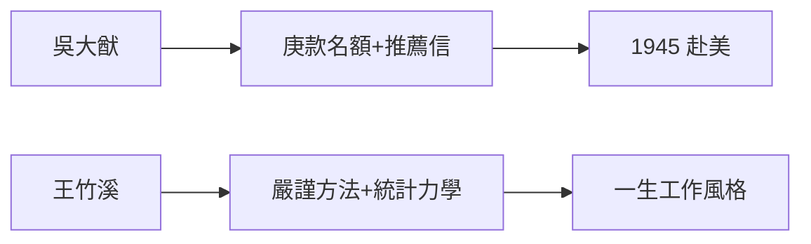

# 2.2 吳大猷與王竹溪的引路

## 吳大猷：伯樂與國門

吳大猷（1907–2000）是聯大物理系主任，也是楊振寧命中的貴人。1944–45 年，吳大猷利用赴美考察的機會，為楊振寧申請到**庚子賠款獎學金**留美名額，並親自寫推薦信給芝加哥大學。

吳大猷的推薦語日後被反覆引用：「楊振寧是我教過的學生中最傑出的一個。」這句話的分量，相當於為一個 22 歲的中國青年打開了世界物理中心的大門。

## 王竹溪：嚴師與方法

王竹溪（1911–1983）是楊振寧的碩士導師，統計力學大師。他教給楊振寧的不是知識點，而是一種工作方法：

- **從小問題入手，做到徹底**：碩士論文只研究一個相變模型，但算到無懈可擊；
- **數學必須乾淨**：物理直覺可以猜，但數學證明不能含糊；
- **文獻要追到源頭**：讀玻爾茲曼、讀吉布斯，不讀二手轉述。

## 兩位導師的合力

吳大猷給了他**機會**（出國），王竹溪給了他**方法**（嚴謹）。楊振寧後來的風格——選題精準、計算乾淨、絕少錯誤——正是兩位老師的合體。

**因果**：沒有吳大猷的推薦，就沒有芝加哥的楊振寧；沒有王竹溪的訓練，芝加哥的楊振寧也走不遠。兩位老師一個開門、一個鋪路，缺一不可。
