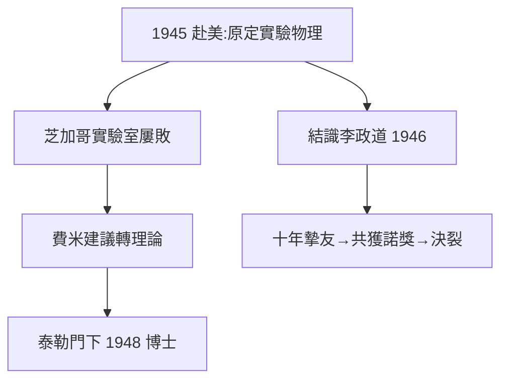

# 2.3 庚款留美與抵達芝加哥

## 1945：橫渡太平洋

1945 年 8 月抗戰勝利，11 月楊振寧搭船赴美。他的原定計劃是跟隨**康普頓**做實驗物理（獎學金指定方向）——一個後來證明完全錯誤的選擇。

## 芝加哥：群星之城

戰後的芝加哥大學物理系是世界中心：費米、泰勒、蓋爾曼（稍後）、楊振寧的同班同學中有李政道（1946 年到）。系主任費米親自給研究生上課，楊振寧選了實驗方向，進實驗室後卻狀況百出——打碎儀器、數據混亂。費米委婉地建議他轉理論：「你的動手能力……還是做理論吧。」

這句話是楊振寧一生的轉折點。他轉向泰勒（Edward Teller）門下做理論博士，1948 年以《強相互作用中的角分佈》獲博士學位。

## 兩個關鍵相遇

1. **李政道（1946）**：同為聯大人（李是貴州人，浙江大學轉聯大），年齡相仿，志趣相投。兩人很快成為無話不談的摯友與合作者——十年後一起拿諾獎，二十年後徹底決裂（見 3.3、4.1）；
2. **費米的風格**：費米「先估計數量級、再做精確計算」的物理直覺，深深影響了楊振寧——在他原有的數學嚴謹之外，補上了物理味道。

**因果**：費米的一句話終結了他的實驗生涯，卻開啟了理論之路；李政道的相遇則埋下了 1956 年宇稱革命的引線。芝加哥的三年，決定了他一生的方向與最重要的合作者。
