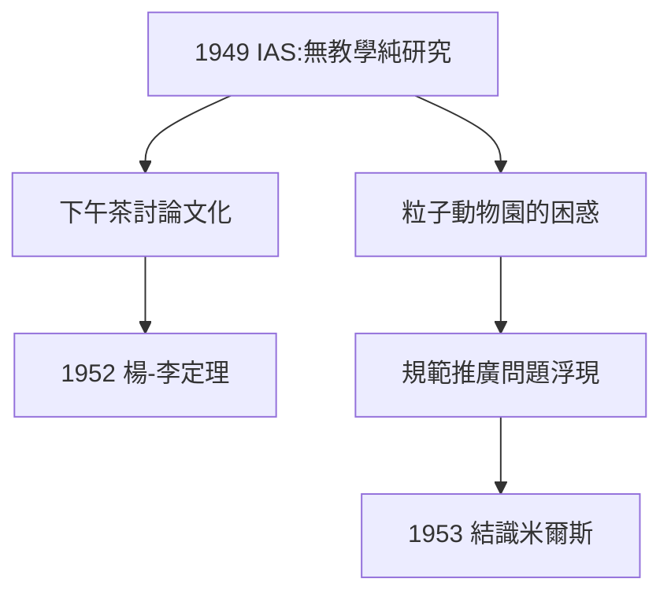

# 3.1 普林斯頓高等研究院

## 奧本海默的邀請

1949 年，楊振寧被普林斯頓高等研究院（IAS）聘為成員，院長是曼哈頓計畫的領導者奧本海默。這裡是愛因斯坦、馮·諾伊曼、哥德爾的家——沒有教學任務、沒有考核，只有無盡的討論。楊振寧後來說，IAS 的下午茶時間是他一生學到最多的課堂。

## 楊-李定理（1952）

在 IAS 的第一個重大成果，是與李政道合作的**楊-李定理**：證明相變在熱力學極限下對應於配分函數零點在複平面上形成連續分佈。這是統計力學中關於相變的第一個嚴格定理，把他碩士時代的相變興趣（2.1）變成了數學定理。

## 1950 年代初的氛圍：尋找「下一個麥克斯韋方程」

當時粒子物理陷入「粒子動物園」：π 介子、K 介子、Λ 超子不斷被發現，理論卻支離破碎。泡利、外爾的老問題重新浮現：**電磁學的規範不變性能否推廣到其他相互作用？**1953 年，楊振寧在布魯克海文國家實驗室做訪問研究，與年輕的米爾斯（Robert Mills）同辦公室——歷史的相遇發生了。

**因果**：IAS 的自由空氣讓他從統計力學轉向場論前沿；楊-李定理證明了他的數學功力，而「規範推廣」的時代問題則為 1954 年的爆發準備好了舞台與搭檔。
