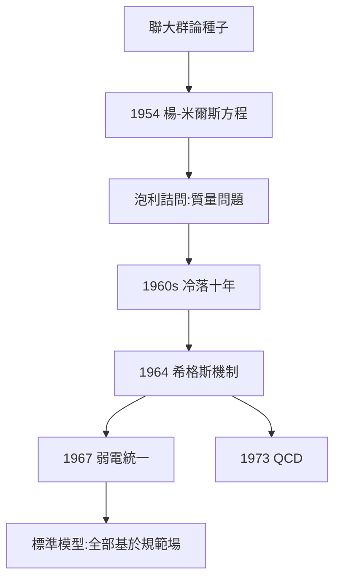

# 3.2 與米爾斯的合作與 1954 年規範場論

## 一個夏天的推廣

1953–54 年，楊振寧與米爾斯把電磁學的 $U(1)$ 規範不變性推廣到同位旋空間的 $SU(2)$ 群：要求拉氏量在**局域**同位旋轉動下不變，必須引入新的規範場 $B_\mu$ ，其場強含非線性自相互作用項：

$$F_{\mu\nu} = \partial_\mu B_\nu - \partial_\nu B_\mu + ig[B_\mu, B_\nu]$$

關鍵思想是聯大本科論文的群論（2.1）在物理中的復活：**對稱性決定相互作用**。

## 1954 年 2 月：泡利的詰問

楊振寧在普林斯頓報告，泡利當場質問：「規範粒子的質量是多少？」（按理論，規範玻色子必須無質量，但當時沒觀測到——這是理論的阿喀琉斯之踵。）楊振寧答不上來，會場沉默。泡利會後卻鼓勵他把論文發表——1954 年 10 月《物理評論》刊出楊-米爾斯論文。

## 從冷遇到封神

- 1960 年代：無質量問題 + 重整化困難，理論被冷落；
- 1964：希格斯機制解決質量問題；
- 1967–68：溫伯格-薩拉姆用 $SU(2)\times U(1)$ 統一弱電；
- 1973：量子色動力學（QCD）用 $SU(3)$ 描述強相互作用；
- 結論：**標準模型的每一根支柱都是楊-米爾斯理論**。

**因果**：一夜的靈感（1954）需要二十年的等待（1964–73）才兌現。這是本書最長的一條因果鏈——從昆明鐵皮屋的群論習題，到日內瓦大型強子對撞機的希格斯玻色子。
