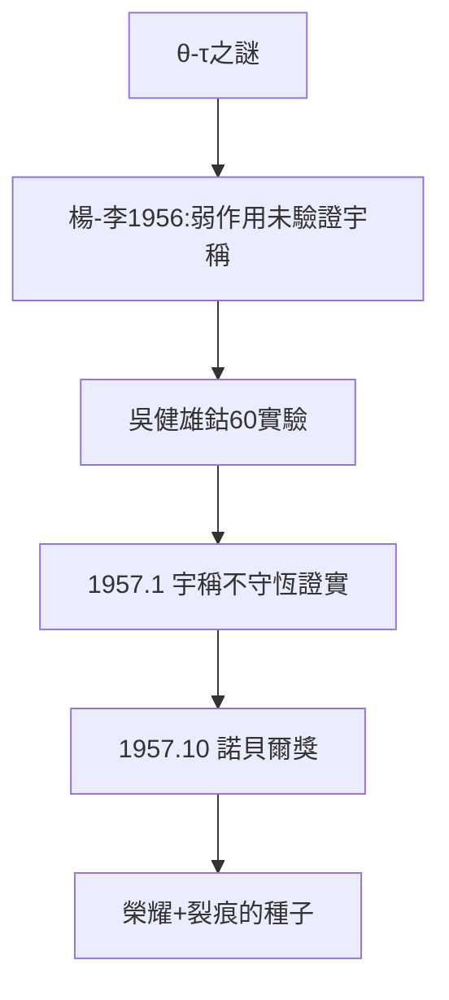

# 3.3 宇稱不守恆與李政道

## θ-τ 之謎

1950 年代中期，K 介子衰變出現怪事：θ 粒子衰變為 2 個 π，τ 粒子衰變為 3 個 π，但兩者質量、壽命完全相同——按宇稱守恆，它們不可能是同一粒子；按其他性質，它們只能是同一粒子。這就是「θ-τ 之謎」。

## 1956：大膽的懷疑

楊振寧與李政道系統檢查了所有「宇稱守恆」的實驗證據，發現：**弱相互作用中從來沒有人驗證過宇稱守恆**——它只是大家想當然的假設。1956 年 6 月他們發表論文，提出弱相互作用中宇稱可能不守恆，並設計了檢驗方案（$^{60}$Co β 衰變的角分佈不對稱）。

## 吳健雄的裁決

哥倫比亞大學的吳健雄（與楊、李同為中國留美學者）立即用極化鈷-60 做了實驗。1957 年 1 月結果公佈：**宇稱確實不守恆**。物理學界震動——一條被視為天經地義的守恆律，在弱相互作用中失效了。

## 1957：諾貝爾獎

1957 年 10 月，楊振寧與李政道同獲諾貝爾物理學獎——楊 35 歲，李 31 歲。頒獎速度之快（發現後不到一年）史無前例，足見其衝擊力。

但榮耀的陰影也在生長：誰的貢獻大？排名先後？媒體的追問在兩位摯友之間埋下裂痕（見 4.1）。

**因果**：規範場（3.2）是楊振寧的「深水炸彈」（二十年後才爆炸），宇稱不守恆則是「閃電戰」（一年內奪獎）。一深一快，構成了他學術生涯的雙峰——也構成了與李政道關係由合到分的轉折點。
