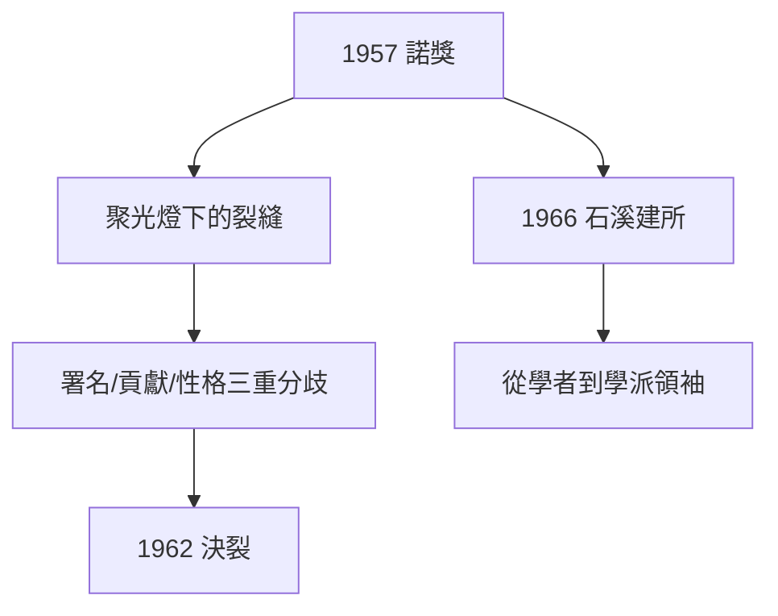

# 4.1 1957 年諾貝爾物理學獎

## 斯德哥爾摩的十二月

1957 年 12 月，楊振寧攜夫人杜致禮赴斯德哥爾摩領獎。他的演講題為《宇稱不守恆的發現》，特別感謝了吳健雄的實驗——這是他一貫的風格：理論家的榮耀分一半給實驗家。

## 獎後的分歧

諾獎的聚光燈照出了合作中的裂縫：

1. **署名與排序**：論文按姓氏字母排序（Lee-Yang 還是 Yang-Lee？），媒體報導的側重；
2. **貢獻認定**：關鍵的物理思想（懷疑宇稱）究竟先出自誰？
3. **性格差異**：楊內斂嚴謹，李外向敏銳，處事方式漸行漸遠。

1962 年左右，兩人正式決裂，此後數十年公開場合互不往來，晚年更因歷史敘述多次筆戰。這是 20 世紀科學史上最令人唏噓的友誼破裂之一。

## 石溪分校：新的基地

1966 年，楊振寧離開 IAS，出任紐約州立大學石溪分校愛因斯坦講座教授兼理論物理研究所首任所長。他把石溪建成美國東岸的理論物理重鎮——從被培養者變成培養者。

**因果**：諾獎既是頂峰也是分水嶺——它結束了「楊-李時代」，開啟了楊振寧作為獨立學派領袖的下半場。下一節，他將在統計力學中開闢第二戰場。
