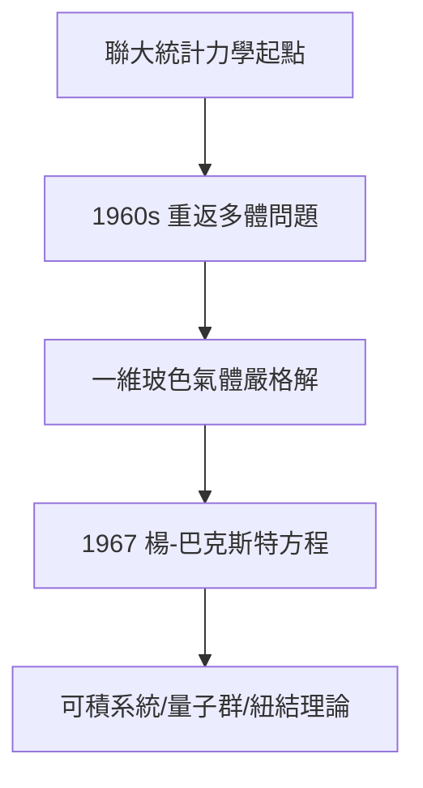

# 4.2 楊-巴克斯特方程與統計力學

## 重返統計力學

拿獎之後，楊振寧沒有躺在場論的功勞簿上，而是回到了王竹溪時代的起點（2.1）：統計力學與多體問題。1960 年代，他與楊振平（弟弟）、 others 系統研究一維玻色氣體（δ 相互作用），用貝特擬設（Bethe ansatz）求出嚴格解——**楊-楊熱力學**。

## 楊-巴克斯特方程（1967）

1967 年，楊振寧在研究一維多體散射的因子化條件時，得到一組矩陣方程：

$$R_{12}R_{13}R_{23} = R_{23}R_{13}R_{12}$$

幾乎同時，澳大利亞的巴克斯特（Rodney Baxter）在八頂點模型中獨立得到同一方程，故名**楊-巴克斯特方程**。它後來成為：

- 可積系統的判據；
- 量子群理論的源頭（德林費爾德 1986 菲爾茲獎工作的主要動機之一）；
- 紐結不變量（瓊斯多項式）的物理基礎。

## 「第二戰場」的意義

多數諾獎得主獲獎後江郎才盡，楊振寧卻在完全不同的領域再開一局。物理學家蓋爾曼評價：「楊振寧的統計力學工作，單獨拿出來也夠一個大獎。」

**因果**：這是「回到起點」的一章——王竹溪的種子（2.1）隔了二十五年開花。它證明楊振寧不是「一個發現的科學家」，而是橫跨場論與統計力學的兩棲大師。
