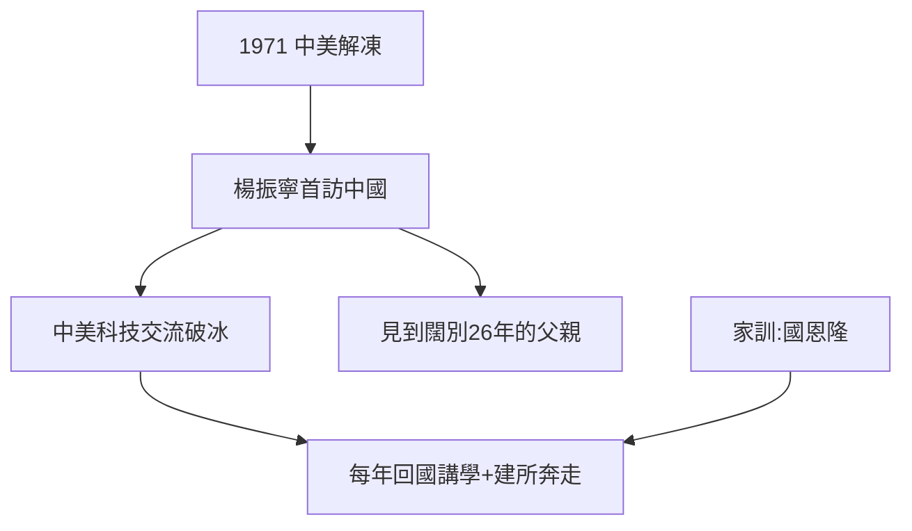

# 4.3 1971 年回到中國

## 破冰之旅

1971 年 7 月，中美關係解凍前夕，楊振寧成為首位回國訪問的美籍華裔科學家。在北京、上海等地，他參觀工廠、學校，與周恩來等領導人座談，並見到了分別 26 年的父親楊武之（時在上海）。

這次訪問的直接後果：

1. 在美國發表訪華觀感，糾正西方對中國的誤解；
2. 促成大批華裔學者回國交流；
3. 1971 年底，他在《紐約時報》撰文呼籲美國科學界與中國合作。

## 兩種聲音

- **讚譽**：架起中美科技交流橋樑的第一人；
- **批評**：有人質疑他「文革期間回國」是否為政治背書；也有人拿他與鄧稼先對比——「一個造原子彈，一個拿諾獎，誰對國家貢獻大？」

楊振寧的回答一以貫之：「我做的是基礎科學，鄧稼先做的是國家需要的應用——分工不同。」多年後他為鄧稼先寫悼文，兩位清華園發小的情誼至死未變。

## 「有生應記國恩隆」的兌現

父親的家訓（1.1）在這一刻落地：從 1971 年起，他每年回國講學，為中國高能物理選址、建所（北京正負電子對撞機的立項有他的推動）奔走。

**因果**：1971 年的破冰，把「個人學術生涯」與「國家科學事業」兩條線擰在一起。從此他的下半生不再只是物理學家的下半生——下一章，他將為此搬回清華園。
