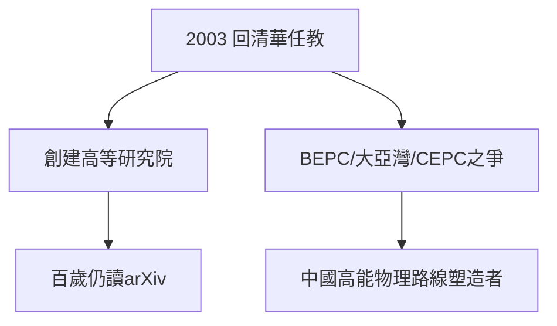

# 5.1 定居清華

## 落葉歸根

2003 年，81 歲的楊振寧正式回清華大學任教，入住清華園；2015 年放棄美國國籍、恢復中國國籍。在清華，他創建高等研究院，親自給本科生上課——講的仍是他最愛的對稱與規範。

## 為中國物理「選址」

- 1980 年代：推動北京正負電子對撞機（BEPC）立項，親自向鄧小平建議；
- 大亞灣中微子實驗：支持王貽芳團隊，2012 年測得 θ₁₃，轟動世界；
- CEPC（環形正負電子對撞機）之爭：晚年他公開反對倉促上馬超大對撞機，與丘成桐等人隔空辯論——爭議至今未息，但無人否認他的出發點是國家經費的審慎使用。

## 婚姻與晚年生活

2004 年與翁帆結婚，輿論譁然；他淡然處之：「這是我個人的選擇。」晚年生活極規律：上午工作、下午散步、晚上讀文獻，百歲仍每天關心 arXiv 新論文。

**因果**：從 1971 年破冰（4.3）到 2003 年定居，他用了 32 年走完「回國」全程。清華園是起點也是終點——1.1 的童年小院與 5.1 的寓所，相距不過數百米。
