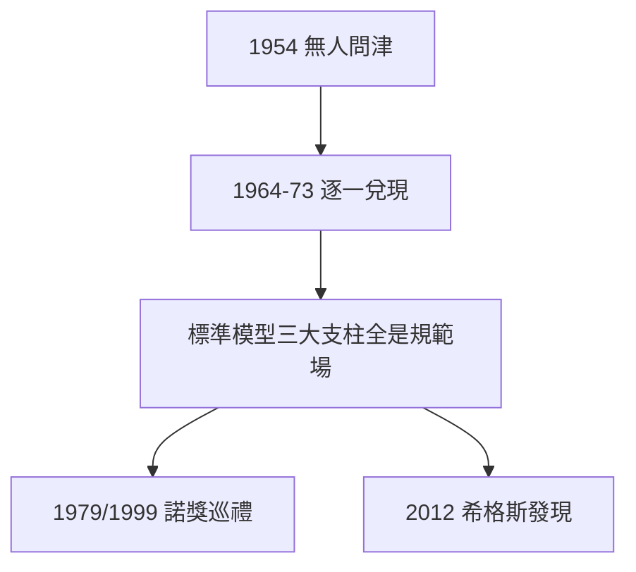

# 5.2 規範場論成為標準模型基石

## 遲到二十年的加冕

楊-米爾斯理論（3.2）發表時無人能解質量問題；到 1970 年代，一切塵埃落定：

| 年份 | 事件 | 與楊-米爾斯的關係 |
|---|---|---|
| 1964 | 希格斯機制 | 賦予規範玻色子質量 |
| 1967–68 | 弱電統一 | $SU(2)\times U(1)$ 規範理論 |
| 1973 | 漸近自由、QCD | $SU(3)$ 規範理論 |
| 1979/1999 | 諾獎授予統一與重整化 | 規範場論的勝利巡禮 |
| 2012 | 希格斯玻色子發現 | 最後一塊拼圖 |

## 外爾的復活

1929 年外爾提出規範不變性時，只是電磁學的數學點綴；楊振寧把它變成**所有基本相互作用的生成原理**。用他自己的話說：「對稱支配相互作用」（Symmetry dictates interaction）——這句話刻在石溪研究所的牆上。

## 與愛因斯坦並列的評價

學界常把 20 世紀物理按貢獻排序：愛因斯坦（相對論）、楊振寧（規範場）各領半壁——前者改寫時空，後者改寫相互作用。美國物理學會的評價是：「楊-米爾斯理論是 20 世紀後半葉物理學最重要的理論框架。」

**因果**：3.2 的種子用了近六十年長成參天大樹。楊振寧的幸運在於長壽——他活到了親眼見證自己理論封神的那一天，這是多數理論家沒有的福分。
