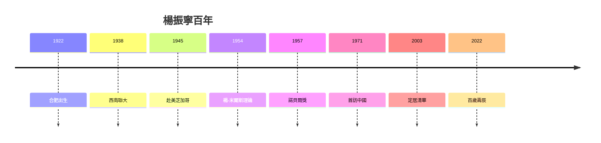

# 5.3 百歲人生與科學遺產

## 2022：百歲壽辰

2022 年 10 月 1 日，楊振寧迎來百歲生日。清華舉辦壽辰研討會，全球物理學家雲集。他在致辭中說：「我這一生，上帝給我的機遇太多了。」——把成就歸於時代與機遇，是他晚年一貫的謙辭。

## 學術遺產清單

1. **楊-米爾斯規範場論**（1954）：標準模型的地基；
2. **宇稱不守恆**（1956–57）：改寫對稱觀，諾貝爾獎；
3. **楊-李定理**（1952）：相變嚴格理論的開端；
4. **楊-巴克斯特方程**（1967）：可積系統與量子群的源頭；
5. **楊-米爾斯存在性問題**：克萊數學研究所千禧年七大難題之一——他的理論至今仍是數學前沿。

## 爭議與蓋棺

關於他的爭議（與李政道決裂、CEPC 之爭、國籍與婚姻）從未停息。但學術史的尺子很長：一個理論被寫進所有教科書、一個方程成為千禧難題——這些不會被輿論改寫。

**因果閉環**：從合肥（1.1）到清華園（5.1），從群論習題（2.1）到千禧難題（5.3）——楊振寧的一生，是「中國學生用西方數學回答宇宙問題，再把答案帶回中國」的完整迴路。父親的家訓，兌現了。
