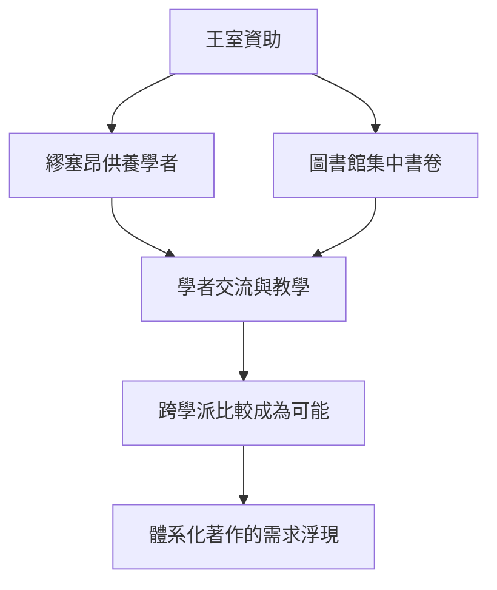

# 1.2 繆塞昂與圖書館

繆塞昂意為繆斯女神之殿，是托勒密王室設立的研究機構，兼具研究院與學者宿舍的功能。學者在其中免費食宿，共同用餐，討論天文、數學、醫學與文獻校勘。與之相連的亞歷山大圖書館，則以收藏天下書卷為目標，據傳藏書達數十萬卷。

圖書館採取積極的收書手段：停靠港口的船隻須交出書卷抄寫，原件留下；派遣使者至雅典、羅得島等地購書；並系統翻譯巴比倫與埃及的文獻。這種集中收藏使學者第一次能同時對照多個學派的著作，比較異同，發現矛盾與缺口。

對數學而言，這意味著畢達哥拉斯學派的數論、希波克拉底的化圓術、歐多克索斯的比例論得以並列陳列。歐幾里德得以站在資料齊全的高點上，辨認何者已被證明、何者尚缺嚴格基礎，進而規劃一部統一的教科書。

## 因果分析

收藏是因，比較是果，體系化是更遠的果。若書卷散落各地，學者只能見一派之言，無法察覺整體結構的鬆散。正是圖書館把分散的知識並置一處，矛盾與重複才變得醒目，驅動了統一整理的工作。繆塞昂的共同生活則加速了口頭討論，使書面比較轉化為教學實踐。可以說，沒有圖書館的廣度，就沒有《幾何原本》的高度。
