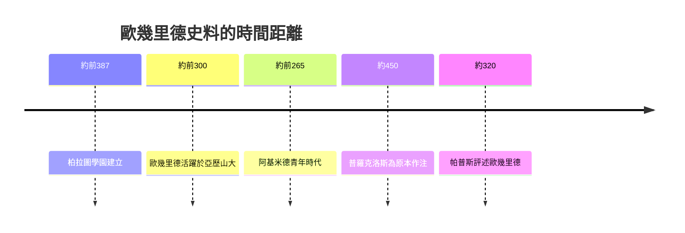

# 1.3 歐幾里德其人

關於歐幾里德本人，史料極為稀少。我們不知道他的確切生卒年，一般推測活躍於前300年前後；不知道出生地，有雅典、推羅等多種說法；也不清楚他的師承，後世傳說他曾在柏拉圖學園學習，但缺乏同時代證據。甚至《幾何原本》是否全為一人所作，也曾引起討論。

少數軼事來自普羅克洛斯與帕普斯數百年後的記載。相傳托勒密王問他有無學習幾何的捷徑，他回答說幾何無王者之道。另一則故事說，有學生學完第一個命題便問能得到什麼好處，他便命人給那學生三個銅板。這些故事雖未必可信，卻勾勒出一個重視嚴格與原則的教師形象。

因此，本書不以生平考證為主線，而以學術脈絡與著作體系為主線。承認無知本身就是一種誠實：歐幾里德的個人生活隱沒了，但他整理知識的方法與時代條件依然清晰可見。

## 因果分析

史料稀缺是因，書寫策略的轉向是果。正因無法依賴編年傳記，後人被迫從制度與著作反推人物：由托勒密的贊助解釋其著述條件，由《幾何原本》的引用溯源其學術師承。這種局限反而帶來益處，使焦點從傳奇軼事轉向可驗證的體系。個人隱退了，時代與文本的因果鏈卻更加突出，這正是理解歐幾里德最可靠的路徑。
