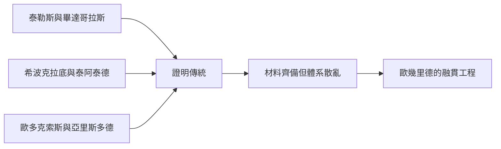

# 2.3 歐幾里德之前的數學版圖

到歐幾里德動筆時，希臘數學已是一片富饒而雜亂的版圖。希波克拉底研究化圓術與月牙形求積，寫過最早的幾何要義；泰阿泰德系統研究正多面體與無理量分類；歐多克索斯給出窮竭法求面積體積；亞里斯多德門下則保存了大量定義與命題的討論。

這些成果各有價值，卻缺乏統一標準。同一命題在不同學派證明詳略不一，術語也不一致。初學者無所適從，研究者難以確認何為已知、何為未知。正如散落的磚石瓦木，材料齊備卻不成宮室。

歐幾里德的工作就是總設計師。他並非多數定理的發明者，而是重組者：篩選材料、統一術語、補足缺環、安排先後次序，使後命題只依賴前命題。這種融貫工作只有在文獻齊聚的亞歷山大才能完成。

## 因果分析

成果的豐富是因，散亂是果，而散亂又成為統一的動因。當知識量超過個人記憶所能駕馭，體系化的需求便自然浮現。前人的分散探索提供了充足建材，也暴露了缺乏總綱的弊病。歐幾里德順勢而為，以教學與整理為切入點，把競爭性的學派成果轉化為累積性的學科傳統。集大成在此不是謙詞，而是精確的因果定位。
