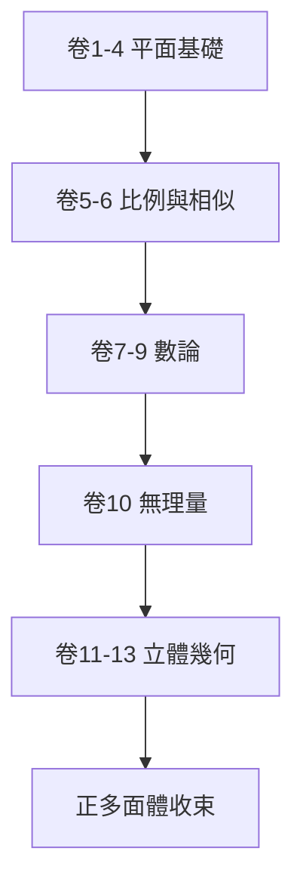

# 3.2 十三卷的結構

《幾何原本》共十三卷，安排極具匠心。第一至四卷處理平面幾何：全等、平行、畢氏定理、圓與正多邊形作圖。第五、六卷為比例論及其在相似形中的應用。第七至九卷為數論，第十卷分類無理量，第十一至十三卷進入立體幾何，最終以五種正多面體作結。

這一順序不是材料的堆砌，而是邏輯的階梯。前卷是後卷的工具：沒有全等就無法談相似，沒有比例就無法處理面積，沒有平面基礎就無法進入立體。每卷內部亦然，命題編號即依賴關係，後命題的證明只能引用已證命題與公設。

全書以正多面體收尾別具深意。它呼應柏拉圖學派以幾何理解宇宙的理想，把實用測量升華為對完美形體的沉思。從最簡單的作圖出發，抵達最對稱的立體，首尾構成完整的求知旅程。

## 因果分析

邏輯順序是因，教學效果與理論強度是果。嚴格的先後安排使初學者能循序漸進，也使研究者能精確定位每個定理的依賴。這種結構反過來強化了演繹理想：知識不再是並列的條目，而是有向的網絡。十三卷的體系化於是既是前人成果的保存器，也是後人研究的導航圖，一舉奠定了教科書的範式。
