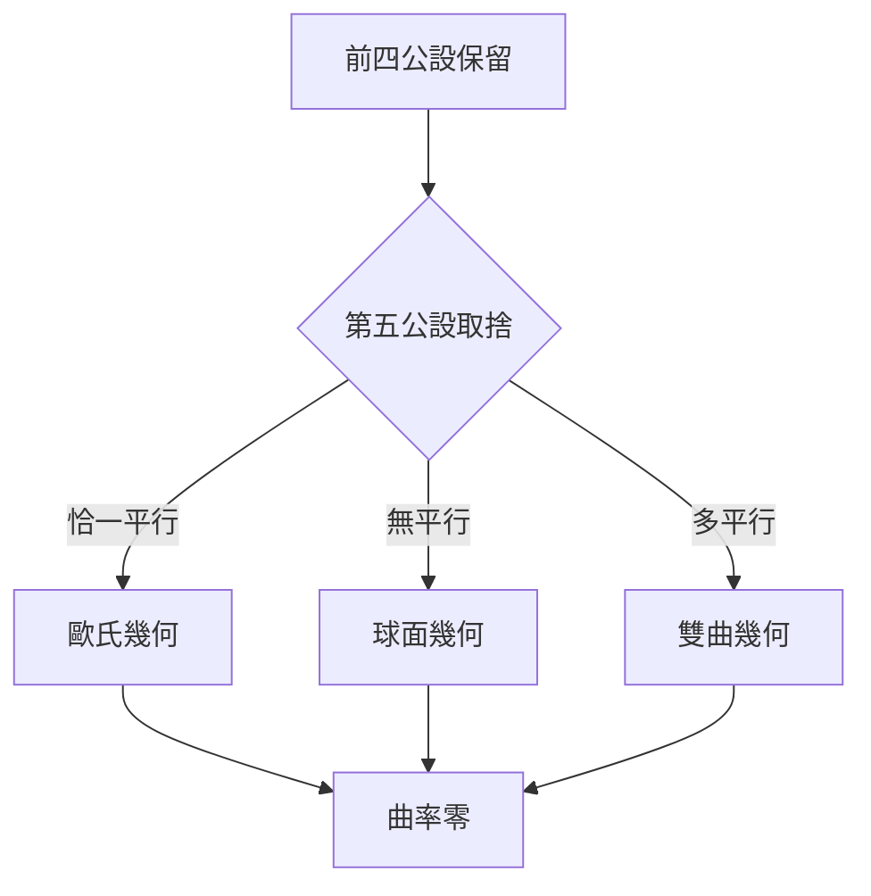

# 4.3 非歐幾何的誕生

十九世紀二十年代，羅巴切夫斯基與鮑耶先後公開發表新幾何：保留前四公設，改設過線外一點有不止一條平行線，仍可得到無矛盾的理論。高斯私下早已洞悉，卻因恐懼爭議未發表。隨後黎曼將幾何推廣到任意彎曲流形，給出內蘊的曲率觀念。

$$ ds^2 = \sum_{i,j} g_{ij} dx^i dx^j $$

此式概括了黎曼度量，歐氏幾何只是曲率為零的特例。球面幾何中三角形內角和大於兩直角，雙曲幾何中小於兩直角，分別對應正負常曲率。貝爾特拉米與克萊因後來給出歐氏模型內的相對一致性證明，確立了非歐幾何與歐氏幾何同等相容。

歐幾里德體系因此獲得新的意義：它不再是空間的唯一真理，而是眾多相容體系中的一個。這不是推翻，而是解放。第五公設的獨立性恰恰證明了公理方法的深刻：改動一條公設，便開啟一個世界。

## 因果分析

千年失敗是因，視角翻轉是果。既然無法證明第五公設，何不假設其反面，看能走多遠。當羅巴切夫斯基把反常當作正常，新幾何便水到渠成。而黎曼的推廣又把三種幾何統一為曲率的不同取值，使歐氏幾何從獨斷真理變為一般理論的特例。因果鏈至此閉環：歐幾里德的嚴格體系孕育了對其自身的懷疑，懷疑最終結出超越自身的果實。
