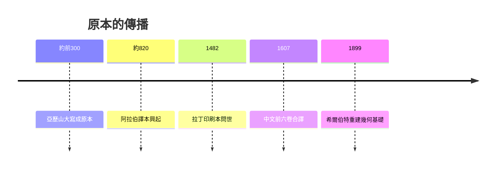

# 5.3 教科書之王

《幾何原本》是歷史上流傳最廣的教科書之一，僅次於《聖經》的版本數量曾被廣泛引用。從阿拉伯譯本到拉丁譯本，從明代徐光啟與利瑪竇合譯《幾何原本》前六卷，到近代各國中學課本，其體例影響深遠。許多人一生所知的證明，便是從全等三角形開始。

它的長壽源於結構而非結論。具體定理或許 outdated，但由淺入深、環環相扣的編排仍是教學的典範。背誦定義、研讀證明、獨立作圖，這套訓練塑造了理性說理的習慣。即使今日教材改用集合與變換語言，仍保留原本先直觀後演繹的節奏。

歐幾里德個人雖隱沒無聞，其名字卻成為嚴格的代名詞。歐氏幾何、歐氏空間、歐氏算法，處處可見。兩千三百年的課堂，是一部以他為起點的理性教育史。

## 因果分析

體系的完整是因，教學的適用是果，文化的延續是更遠的果。正因原本自足而有序，教師無須另尋材料，學生得以一書入門。廣泛使用又帶來大量注疏與翻譯，進一步鞏固其權威，形成自我強化的循環。歐幾里德的真正遺產因此不在某條定理，而在證明了知識可以如此組織並傳授。方法一旦成為制度，便超越了個人生命的局限。
