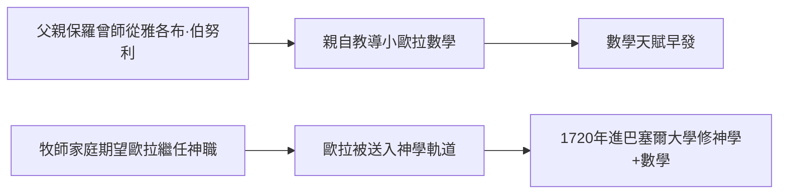

# 1.1 1707年 巴塞爾的牧師之子

## 事件

1707 年 4 月 15 日，萊昂哈德·歐拉（Leonhard Euler）出生於瑞士巴塞爾，父親保羅·歐拉（Paul Euler）是新教加爾文派的牧師。次年全家遷往里恩（Riehen）郊區的牧師宅。

## 前因：宗教與數學的雙重基因

- 父親保羅年輕時曾在巴塞爾大學修過雅各布·伯努利（Jacob Bernoulli）的數學課，本人對數學有相當素養。
- 母親瑪格麗特·布魯克（Margaretha Brucker）出身牧師家庭。
- 家族對歐拉的期望是**接任牧職**——這個期望後來幾乎改變了數學史。

## 後果：父親的數學家教成為起點

保羅親自教導幼年歐拉數學，成為歐拉最早的啟蒙。宗教教育則塑造了歐拉終身的性格：虔誠、節制、勤奮——這種「修士般的工作紀律」支撐了他一生每天數學寫作的習慣。

## 意義

歐拉的一生不斷重演「牧師之子」與「數學家」的張力：他終身保持虔誠信仰，卻把全部才華獻給了數學。這份張力在後來幾次重大抉擇（聖彼得堡之約、離開柏林）中都可以看到影子。
