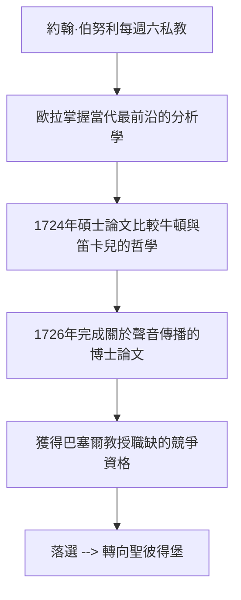

# 1.2 1720年 十三歲入巴塞爾大學

## 事件

1720 年 10 月，13 歲的歐拉進入巴塞爾大學，官方身分是**神學院學生**。他同時修習數學，師從約翰·伯努利（Johann Bernoulli，雅各布之弟）。

## 前因

- 當時大學入學年齡普遍偏早，巴塞爾大學規模很小。
- 約翰·伯努利發現這個少年質疑課本內容的能力遠超同儕。

## 關鍵細節：每週六下午的私教

歐拉晚年回憶，約翰·伯努利注意到他主動去借更高深的書自學，於是提出：**每週六下午，歐拉可以把不懂的問題帶來，伯努利會親自解答**。這種「自學+單獨答疑」的模式，比課堂教學高效得多。

> 歐拉後來寫道：「他幾乎給了我一切我需要的指導……而我做的一切，都是為了不讓他失望。」

## 後果

## 為什麼「落選」反而是轉機？

1726 年巴塞爾有一個物理學教授職缺，19 歲的歐拉競爭失敗。但這次落選直接把他推向了外面的世界——同時，聖彼得堡科學院正在全球招募年輕學者（見 2.1 節）。若歐拉當時順利留任，18 世紀數學史可能完全改寫。
