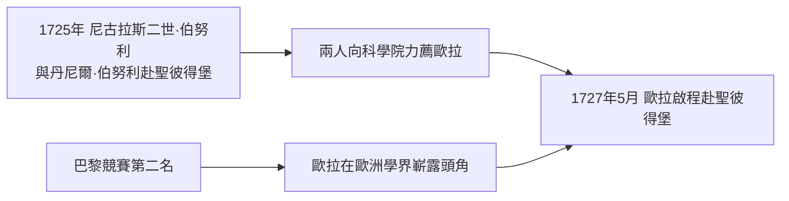

# 1.3 1727年 巴黎競賽與伯努利家族的推薦

## 事件

1727 年，20 歲的歐拉以論文參加**巴黎科學院大獎競賽**（主題：船桅杆的最佳配置），獲得第二名。同年，他啟程前往聖彼得堡。

## 前因：伯努利家族的雙重推薦

- 約翰·伯努利的兩個兒子——**尼古拉斯二世（Nicolaus II）與丹尼爾（Daniel）**——於 1725 年受聘前往新建的聖彼得堡科學院。他們持續寫信推薦歐拉。
- 巴黎競賽的佳績證明了這個推薦的分量。歐拉此生共獲得巴黎科學院大獎 **12 次**。

## 前因：俄羅斯為何需要數學家？

1725 年彼得大帝（Peter the Great）去世，但他建立的**聖彼得堡科學院**剛剛成立。彼得推行西化改革，需要西方科學家替帝國建立現代化的知識體系（製圖、航海、曆法、礦冶）。科學院以優厚條件招募西歐學者——這是整個 18 世紀「人才全球化」的一個縮影。

## 後果

1727 年 5 月，歐拉抵達聖彼得堡。他沒想到的是，就在他抵達前後，兩件大事同時發生：

1. 彼得大帝去世後的宮廷過渡期，科學院一度瀕臨解散（見 2.1）。
2. 尼古拉斯二世在 1726 年已因闌尾炎去世——歐拉到任後，與丹尼爾成為科學院數學的中樞。
