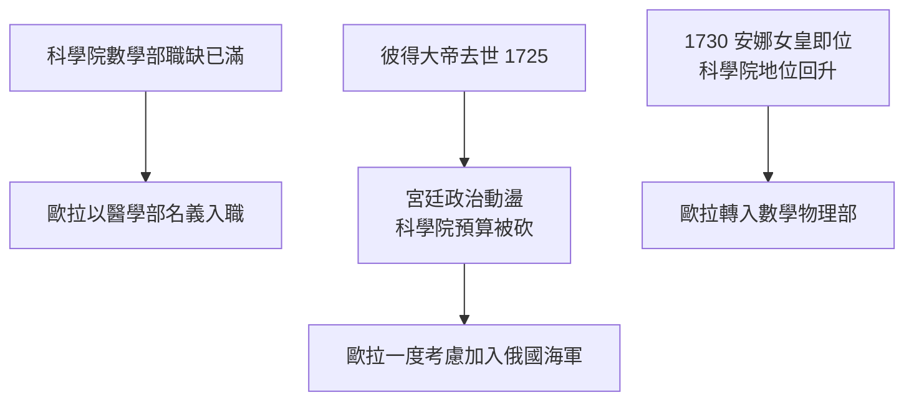

# 2.1 1727年 丹尼爾·伯努利的邀請

## 事件

1727 年歐拉抵達聖彼得堡科學院，最初被分派到**醫學部**（當時缺額所在），同時兼任海軍中尉的醫務候補。1730 年轉入數學-物理部門。

## 前因：一段尷尬的入職

歐拉本來想當數學家，卻先被派去學醫——當年巴塞爾也有類似的「不讓他學數學」的安排。命運兩次把歐拉推向非數學領域，兩次都以數學部的轉入收場。

## 與丹尼爾的黃金搭檔（1727-1733）

歐拉與丹尼爾·伯努利同住，密切合作：

- 共同研究流體力學（後來丹尼爾的《流體力學》1738 引用大量歐拉計算）。
- 一起研究弦振動問題——這是**變分法與偏微分方程的前夜**。
- 丹尼爾在概率論（聖彼得堡悖論，1738）上的工作也與歐拉反覆討論。

## 後果

這六年奠定了歐拉的分析學基本功。1733 年丹尼爾回瑞士，歐拉接任數學教授（見 2.2）。兩人此後通信三十年，是 18 世紀最重要的數學通信之一。
