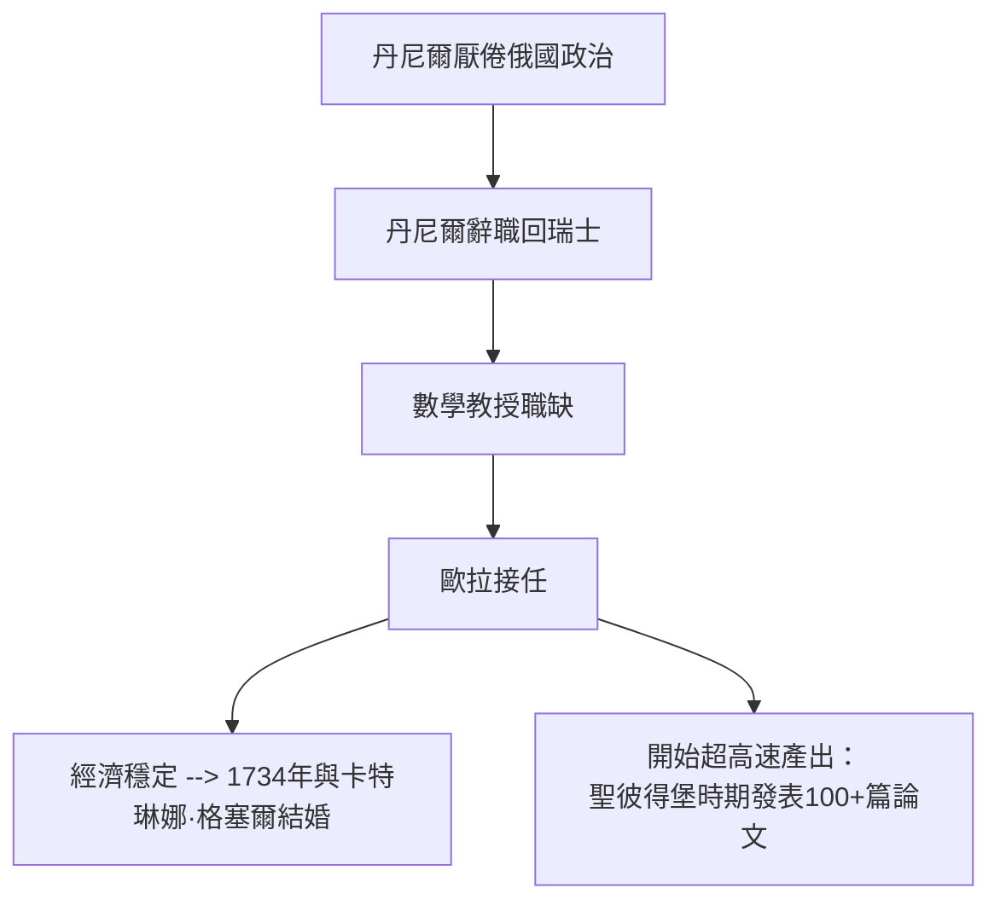

# 2.2 1733年 接掌數學教授

## 事件

1733 年，丹尼爾·伯努利厭倦俄羅斯的政治環境返回巴塞爾，26 歲的歐拉接任聖彼得堡科學院**數學教授**。

## 前因後果鏈

## 高產的秘密：科學院的期刊制度

聖彼得堡科學院出版《科學院評論》（Commentarii），歐拉幾乎每卷都投多篇論文。他終身保持**每天下午寫作數學、晚上與家人相處**的節奏，並以驚人的記憶力（能背出維吉爾《埃涅阿斯紀》全書）與計算能力支撐產出。

## 此時期的重要成果

| 年份 | 成果 |
|------|------|
| 1735 | 解決巴塞爾問題： $\sum 1/n^2 = \pi^2/6$ |
| 1736 | 兩篇力學巨著《力學》（Mechanica）出版 |
| 1736 | 柯尼斯堡七橋問題論文（圖論誕生） |
| 1737 | 引入常數 $e$ 的記號 |

## 巴塞爾問題的意義

歐拉 1735 年解出 $\zeta(2)=\pi^2/6$ 時年僅 28 歲。這個問題困擾歐洲數學界近百年（伯努利家族都解不開）。歐拉的解法大膽地把有限多項式因式分解的方法**推廣到無窮級數**——這種「無窮也服從代數規則」的信念，正是他日後分析學革命的哲學核心。
